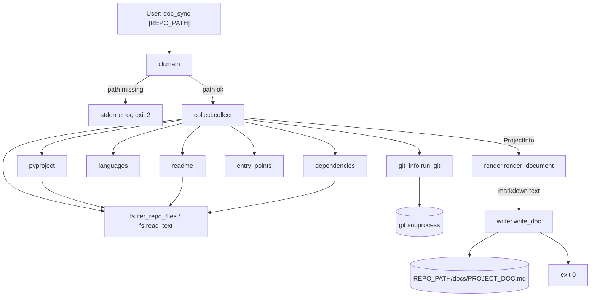

# Architecture: Automated Documentation Sync

Input: `docs/requirements.md` (final). Format: `.claude/skills/doc-sync-format/SKILL.md`.
Scope: a single Python 3.11 CLI package under `src/doc_sync/`, standard library only.

## Components

All modules live in `src/doc_sync/`. Every function has type hints (NFR-1) and does one job (NFR-5).
Collectors return `None` (scalar) or `[]` (list) when data is missing. Only `render.py` turns that into `Not Found`.

| Module | Responsibility | Public interface |
|---|---|---|
| `__main__.py` | Lets `python -m doc_sync` work | calls `cli.main()` |
| `cli.py` | Parse args, validate `REPO_PATH`, orchestrate, exit codes | `parse_args(argv: list[str] \| None) -> argparse.Namespace`; `resolve_repo(path: str \| None) -> Path \| None`; `main(argv: list[str] \| None = None) -> int` |
| `fs.py` | Shared safe file helpers | `read_text(path: Path) -> str \| None`; `iter_repo_files(root: Path) -> list[Path]` |
| `pyproject.py` | Read `pyproject.toml` | `load_pyproject(root: Path) -> dict[str, Any]`; `project_field(data: dict[str, Any], key: str) -> str \| None`; `project_scripts(data: dict[str, Any]) -> list[str]` |
| `readme.py` | Read `README.md` | `load_readme(root: Path) -> str \| None`; `first_heading(text: str) -> str \| None`; `first_paragraph(text: str) -> str \| None`; `section_body(text: str, titles: tuple[str, ...]) -> str \| None` |
| `languages.py` | Extension table and detection | `EXTENSION_LANGUAGES: dict[str, str]`; `detect_languages(files: list[Path]) -> list[str]` |
| `dependencies.py` | Read `requirements.txt` | `parse_requirements(text: str) -> list[str]`; `read_dependencies(root: Path) -> list[str]` |
| `entry_points.py` | Collect entry points | `entry_point_files(root: Path, files: list[Path]) -> list[str]`; `collect_entry_points(root: Path, data: dict[str, Any], files: list[Path]) -> list[str]` |
| `git_info.py` | Safe git invocation | `run_git(root: Path, args: list[str]) -> str \| None`; `last_commit(root: Path) -> str \| None` |
| `collect.py` | Build the data model | `ProjectInfo` (frozen dataclass); `first_present(*values: str \| None) -> str \| None`; `collect(root: Path) -> ProjectInfo` |
| `render.py` | Markdown output and the single `Not Found` rule | `NOT_FOUND: Final = "Not Found"`; `SECTION_ORDER: Final[tuple[str, ...]]`; `render_text(value: str \| None) -> str`; `render_list(items: list[str]) -> str`; `render_document(info: ProjectInfo) -> str` |
| `writer.py` | Write output file | `write_doc(root: Path, content: str) -> Path` |

`ProjectInfo` fields: `name: str | None`, `description: str | None`, `languages: list[str]`, `dependencies: list[str]`, `entry_points: list[str]`, `how_to_run: str | None`, `last_commit: str | None`.

Shared helpers (no duplicated logic, NFR-5):
- `fs.read_text` is the only file reader (pyproject, README, requirements).
- `fs.iter_repo_files` walks the repo once. Languages and entry points both use the result.
- `collect.first_present` handles the per-field precedence for Name and Description (FR-15, FR-16).
- `render.render_text` and `render.render_list` are the only places that produce `Not Found` (FR-9, FR-10).
- `git_info.run_git` is the only subprocess call site.

Parsing rules:
- `first_heading`: the first ATX heading line (`#` to `######`), text with the `#` marks and whitespace removed.
- `first_paragraph`: the first block of consecutive non-blank lines that is not a heading. Lines are joined with single spaces.
- `section_body`: finds a heading whose text matches `Usage` or `How to Run` case-insensitively. The body is the text up to the next heading of the same or higher level, stripped. An empty body returns `None` (FR-14).
- `parse_requirements`: strips each line, skips blank lines and lines starting with `#`, keeps other lines as written, in file order. Nothing is resolved or guessed (FR-12).
- `project_scripts`: each `[project.scripts]` entry renders as `<name> = <target>`, in declared order.
- `entry_point_files`: repo-relative POSIX paths of files named `__main__.py` or `main.py`, sorted. Output is scripts first, then files (FR-13).
- `iter_repo_files`: recursive walk. It skips any `.git` directory (FR-6) and the output file `docs/PROJECT_DOC.md`, so a previous run cannot change the next result (NFR-6). It does not follow symlinked directories. It returns a sorted list.

## Mermaid Diagram

## Data Flow

1. `cli.main` parses the optional `REPO_PATH`. If it is omitted, it uses `Path.cwd()` (FR-1, FR-17).
2. `resolve_repo` returns `None` if the path does not exist. `main` then prints `doc_sync: REPO_PATH not found: <path>` to stderr, writes nothing, and returns 2 (FR-23).
3. `collect.collect(root)`:
   - It loads `pyproject.toml` (or `{}`) and `README.md` (or `None`) once.
   - Name = `first_present(project_field(data, "name"), first_heading(readme))` (FR-15).
   - Description = `first_present(project_field(data, "description"), first_paragraph(readme))` (FR-16).
   - It calls `files = iter_repo_files(root)` once, then `detect_languages(files)` (FR-6, FR-20) and `collect_entry_points(root, data, files)` (FR-13).
   - Dependencies come from `read_dependencies(root)` (FR-7).
   - How to Run = `section_body(readme, ("Usage", "How to Run"))` (FR-14).
   - Last Commit comes from `last_commit(root)` (FR-8, FR-19).
4. `render_document(info)` builds the output: the title `# <name>` or `# Not Found` (FR-3), then the 7 sections in `SECTION_ORDER` (FR-4). Scalar sections use `render_text` and list sections use `render_list` (FR-9, FR-10). The text ends with a single trailing newline.
5. `write_doc` runs `mkdir(parents=True, exist_ok=True)` on `<root>/docs` and writes UTF-8 with `\n` newlines. It always overwrites (FR-18, FR-21).
6. `main` returns 0 (FR-22). The console script `doc_sync = "doc_sync.cli:main"` is declared in this project's `pyproject.toml` and passes the return value to `sys.exit`.

Console output on success is one line, `Wrote <path>`. File contents and environment values are never printed (NFR-2).

### Extension-to-language table (resolves OI-4)

Matching uses `Path.suffix.lower()`. Each language is listed once and sorted alphabetically (FR-20). Extensions that are not in the table are ignored.

| Extensions | Language |
|---|---|
| `.c`, `.h` | C |
| `.cs` | C# |
| `.cpp`, `.cc`, `.cxx`, `.hpp`, `.hh` | C++ |
| `.css` | CSS |
| `.go` | Go |
| `.html`, `.htm` | HTML |
| `.java` | Java |
| `.js`, `.mjs`, `.cjs`, `.jsx` | JavaScript |
| `.kt`, `.kts` | Kotlin |
| `.php` | PHP |
| `.ps1`, `.psm1` | PowerShell |
| `.py`, `.pyi` | Python |
| `.rb` | Ruby |
| `.rs` | Rust |
| `.scala` | Scala |
| `.sh`, `.bash` | Shell |
| `.sql` | SQL |
| `.swift` | Swift |
| `.ts`, `.tsx` | TypeScript |

Markup and data formats (`.md`, `.json`, `.yaml`, `.toml`, `.txt`) are left out on purpose. This keeps the generated `.md` output from feeding into later runs.

### Git invocation

- `run_git` calls `subprocess.run(["git", "-C", str(root), *args], shell=False, capture_output=True, text=True, encoding="utf-8", errors="replace", stdin=subprocess.DEVNULL, timeout=10, check=False)`.
- `last_commit` passes `["log", "-1", "--format=%h %ad %s", "--date=short"]` (FR-19). The arguments are a list, so the format string needs no shell quoting.
- The output is stripped. An empty result is `None`.
- No shell is used. No user input is placed into a command string, because `root` is a single argv element. The environment is inherited unchanged and the tool does not read or log it. git stderr is discarded and never echoed (NFR-2). No credentials are needed (NFR-3).

## Technology Choices

| Need | Choice | Reason |
|---|---|---|
| Runtime | Python 3.11 | NFR-1 |
| CLI parsing | `argparse` (stdlib) | One optional positional, no extra dependency |
| TOML | `tomllib` (stdlib in 3.11) | No extra dependency |
| Paths / walk | `pathlib`, `os.walk` | Lets the walk prune `.git` without descending into it |
| Git | `git` binary via `subprocess` | FR-8, FR-19. No git library needed |
| Data model | `dataclasses` (frozen) | Plain, immutable, easy to test |
| Tests | `pytest` with `tmp_path`, `monkeypatch`, `capsys` | CLAUDE.md, NFR-4 |
| External APIs | None other than git. Atlassian/GitHub: Not Found in requirements | Q7 |

## Error Handling

| Failure mode | Detection | Behaviour | Req |
|---|---|---|---|
| `REPO_PATH` does not exist | `resolve_repo` returns `None` | Short stderr message, no file written, exit 2 | FR-23 |
| `REPO_PATH` is a file, not a directory | `Path.is_dir()` is false | Treated like a missing path (exit 2). The requirements do not cover this case (Not Found), so it is a design decision for review | FR-23 |
| `pyproject.toml` missing or unreadable | `read_text` returns `None` (`OSError`, `UnicodeDecodeError`) | `{}`, so the fields fall back or become `Not Found` | FR-10, FR-11 |
| `pyproject.toml` invalid TOML | `tomllib.TOMLDecodeError` caught in `load_pyproject` | `{}` | FR-11 |
| `[project].name`/`description` not a non-empty string | Type and strip check in `project_field` | `None`, then fallback | FR-12, FR-15, FR-16 |
| `README.md` missing, empty, or without a heading/paragraph/usage section | Helpers return `None` | The affected field becomes `Not Found` | FR-10, FR-14 |
| `requirements.txt` missing, empty, or only comments | Returns `[]` | `Not Found` | FR-9, FR-10 |
| Empty repo (no files) | `iter_repo_files` returns `[]` | All file-based sections are `Not Found`, exit 0 | FR-11, FR-22 |
| Unreadable directory during walk | `os.walk(onerror=...)` ignores it | The rest of the scan continues | FR-11 |
| git not installed | `FileNotFoundError` caught in `run_git` | `None`, Last Commit is `Not Found` | FR-11 |
| Not a git repo, or no commits | Non-zero return code | `None` | FR-11 |
| git hangs | `subprocess.TimeoutExpired` caught | `None` | FR-11 |
| git empty output | Strip leaves an empty string | `None` | FR-10 |
| Cannot create `docs/` or write the file | `OSError` in `write_doc` | The exit code is Not Found in the requirements. Proposed: short stderr message without contents, exit 1. Flag for design review | Not Found |

No collector raises an exception to `collect`. Each one catches its own expected exceptions and returns `None`/`[]`. Only `OSError` from `write_doc` reaches `main`.

## Testing Strategy

Tests live in `tests/` and use pytest. Each test builds a fixture repo in `tmp_path`. Git tests create a real repo with `git init` and a commit, and skip if git is unavailable. The failure-path tests monkeypatch `subprocess.run`.

| Test file | Covers |
|---|---|
| `test_cli.py` | Default cwd (FR-17), explicit path (FR-1), exit 0 with `Not Found` sections (FR-22), missing path gives exit 2, stderr text and no file (FR-23), success line contains no env values (NFR-2) |
| `test_render.py` | Title line (FR-3), exact section order and count (FR-4), `- item` lists (FR-9), exact `Not Found` string (FR-10) |
| `test_pyproject.py` | name/description/scripts (FR-5, FR-15, FR-16), invalid TOML and missing file (FR-11) |
| `test_readme.py` | First heading, first paragraph, Usage / How to Run section, absent section (FR-5, FR-14, FR-15, FR-16) |
| `test_precedence.py` | pyproject wins over README, with fallback decided per field (FR-15, FR-16) |
| `test_languages.py` | Table mapping, case-insensitivity, unknown extensions ignored, dedupe and sort, `.git` excluded (FR-6, FR-20) |
| `test_dependencies.py` | Parsing, comments and blanks skipped, missing file (FR-7, FR-9) |
| `test_entry_points.py` | Scripts plus `__main__.py`/`main.py`, `.git` excluded (FR-13) |
| `test_git_info.py` | Format `<sha> YYYY-MM-DD <subject>` (FR-8, FR-19), no git / non-repo / timeout give `None` (FR-11), argv list with `shell=False` (NFR-2) |
| `test_writer.py` | Creates `docs/` (FR-18), overwrites (FR-21), write error (Not Found) |
| `test_end_to_end.py` | Full repo (FR-2), empty repo with all `Not Found` (FR-11), no invented content (FR-12), two runs give identical output (NFR-6), a dummy secret env var never appears in output (NFR-2) |
| Static checks | `mypy --strict` or an annotation check for signatures (NFR-1). Review checks for single-purpose functions and duplication (NFR-5) |

## Requirement Traceability

| Req | Component(s) | Test(s) |
|---|---|---|
| FR-1 | `cli.parse_args`, `cli.main`, console script | `test_cli.py` |
| FR-2 | `cli.main`, `collect`, `render`, `writer` | `test_end_to_end.py` |
| FR-3 | `render.render_document` | `test_render.py` |
| FR-4 | `render.SECTION_ORDER`, `render.render_document` | `test_render.py` |
| FR-5 | `pyproject.project_field`, `readme.first_heading`, `readme.first_paragraph` | `test_pyproject.py`, `test_readme.py` |
| FR-6 | `fs.iter_repo_files`, `languages.detect_languages` | `test_languages.py` |
| FR-7 | `dependencies.read_dependencies`, `dependencies.parse_requirements` | `test_dependencies.py` |
| FR-8 | `git_info.last_commit` | `test_git_info.py` |
| FR-9 | `render.render_list` | `test_render.py`, `test_dependencies.py` |
| FR-10 | `render.NOT_FOUND`, `render.render_text`, `render.render_list` | `test_render.py` |
| FR-11 | `fs.read_text`, `pyproject.load_pyproject`, `git_info.run_git`, `fs.iter_repo_files` | `test_end_to_end.py`, `test_git_info.py`, `test_pyproject.py` |
| FR-12 | All collectors (`None`/`[]` instead of guesses), `collect` | `test_end_to_end.py` |
| FR-13 | `entry_points`, `pyproject.project_scripts` | `test_entry_points.py` |
| FR-14 | `readme.section_body` | `test_readme.py` |
| FR-15 | `collect.first_present`, `pyproject.project_field`, `readme.first_heading` | `test_precedence.py` |
| FR-16 | `collect.first_present`, `pyproject.project_field`, `readme.first_paragraph` | `test_precedence.py` |
| FR-17 | `cli.resolve_repo` | `test_cli.py` |
| FR-18 | `writer.write_doc` | `test_writer.py` |
| FR-19 | `git_info.last_commit`, `git_info.run_git` | `test_git_info.py` |
| FR-20 | `languages.EXTENSION_LANGUAGES`, `languages.detect_languages` | `test_languages.py` |
| FR-21 | `writer.write_doc` | `test_writer.py` |
| FR-22 | `cli.main` | `test_cli.py` |
| FR-23 | `cli.resolve_repo`, `cli.main` | `test_cli.py` |
| NFR-1 | All modules (type hints) | Static check |
| NFR-2 | `git_info.run_git`, `cli.main`, `render` (no env reads) | `test_end_to_end.py`, `test_cli.py`, `test_git_info.py` |
| NFR-3 | `git_info.run_git` (inherited env, no credentials) | `test_git_info.py` |
| NFR-4 | `tests/` suite | All test files |
| NFR-5 | Shared helpers: `fs`, `collect.first_present`, `render`, `git_info.run_git` | Review |
| NFR-6 | `fs.iter_repo_files` (sorted, skips output), `languages` (sorted), `writer` (overwrite, `\n`) | `test_end_to_end.py` |

## Open Design Questions
- `REPO_PATH` exists but is not a directory: requirements Not Found. Proposed exit 2.
- Output write failure exit code: requirements Not Found. Proposed exit 1.
