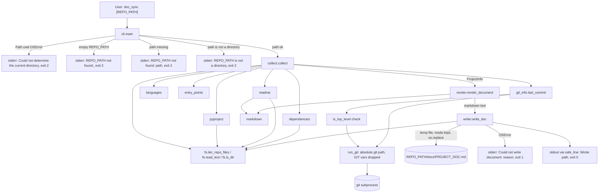

# Architecture: Automated Documentation Sync

Input: `docs/requirements.md` (final-with-open-item, FR-1..FR-28, NFR-1..NFR-6). Format: `.claude/skills/doc-sync-format/SKILL.md`.
Revision: applies `docs/design-review.md` DR-1..DR-15 (all Accepted). DR-11 is recorded as OI-7 only and is not implemented.
Code-review follow-up: matches the implemented code after `docs/code-review.md` CR-1..CR-12 (all Accepted). See "Changes after code review".
Scope: a single Python 3.11 CLI package under `src/doc_sync/`, standard library only.

## Components

All modules live in `src/doc_sync/`. Every function has type hints (NFR-1) and does one job (NFR-5).
Collectors return `None` (scalar) or `[]` (list) when data is missing. Only `render.py` turns that into `Not Found`.

| Module | Responsibility | Public interface |
|---|---|---|
| `__main__.py` | Lets `python -m doc_sync` work and pass on the exit code (DR-8) | `sys.exit(cli.main())` under `if __name__ == "__main__":` |
| `cli.py` | Parse args, validate `REPO_PATH`, orchestrate, exit codes, safe console lines | `parse_args(argv: Sequence[str] \| None = None) -> argparse.Namespace`; `resolve_repo(path: Path) -> Path \| None`; `path_error(path: Path) -> str`; `safe_line(text: str) -> str`; `write_failure(exc: OSError) -> str`; `main(argv: Sequence[str] \| None = None) -> int` |
| `fs.py` | Shared safe file helpers and the output path constant | `GIT_DIR = ".git"`; `OUTPUT_RELATIVE = ("docs", "PROJECT_DOC.md")`; `read_text(path: Path) -> str \| None`; `is_dir(path: Path) -> bool`; `iter_repo_files(root: Path) -> list[Path]` |
| `markdown.py` | Shared Markdown line rules (used by `readme` and `render`, NFR-5) | `Heading` (NamedTuple: `start`, `end`, `level`, `text`); `atx_heading(line: str) -> tuple[int, str] \| None`; `setext_level(line: str) -> int \| None`; `fence_flags(lines: list[str]) -> tuple[list[bool], str \| None]`; `find_headings(lines: list[str]) -> list[Heading]`; `split_container(line: str) -> tuple[str, str]`; `is_html_heading(line: str) -> bool`; `is_html_only(line: str) -> bool` |
| `pyproject.py` | Read `pyproject.toml` | `load_pyproject(root: Path) -> dict[str, Any]`; `project_table(data: dict[str, Any]) -> dict[str, Any]`; `project_field(data: dict[str, Any], key: str) -> str \| None`; `project_scripts(data: dict[str, Any]) -> list[str]` |
| `readme.py` | Read `README.md` | `load_readme(root: Path) -> str \| None`; `first_heading(text: str) -> str \| None`; `first_paragraph(text: str) -> str \| None`; `section_body(text: str, titles: tuple[str, ...]) -> str \| None` |
| `languages.py` | Extension table and detection | `EXTENSION_LANGUAGES: dict[str, str]`; `detect_languages(files: list[Path]) -> list[str]` |
| `dependencies.py` | Read `requirements.txt` safely | `strip_url_credentials(text: str) -> str`; `join_continuations(text: str) -> list[str]`; `clean_requirement(line: str) -> str \| None`; `parse_requirements(text: str) -> list[str]`; `read_dependencies(root: Path) -> list[str]` |
| `entry_points.py` | Collect entry points | `entry_point_files(root: Path, files: list[Path]) -> list[str]`; `collect_entry_points(root: Path, data: dict[str, Any], files: list[Path]) -> list[str]` |
| `git_info.py` | Safe git invocation | `find_git(root: Path) -> str \| None`; `git_env() -> dict[str, str]`; `run_git(root: Path, args: list[str]) -> str \| None`; `is_top_level(root: Path) -> bool`; `last_commit(root: Path) -> str \| None` |
| `collect.py` | Build the data model | `ProjectInfo` (frozen dataclass); `first_present(*values: str \| None) -> str \| None`; `collect(root: Path) -> ProjectInfo` (private `_readme_field(readme: str \| None, parser: Callable[[str], str \| None]) -> str \| None`) |
| `render.py` | Markdown output and the single `Not Found` rule | `NOT_FOUND: Final = "Not Found"`; `SECTION_ORDER: Final[tuple[str, ...]]`; `single_line(value: str) -> str`; `safe_body(text: str) -> str`; `render_text(value: str \| None) -> str`; `render_list(items: list[str]) -> str`; `render_document(info: ProjectInfo) -> str` |
| `writer.py` | Atomic output write, mode preserved | `atomic_write(path: Path, text: str) -> None`; `write_doc(root: Path, text: str) -> Path` |

`ProjectInfo` fields: `name: str | None`, `description: str | None`, `languages: list[str]`, `dependencies: list[str]`, `entry_points: list[str]`, `how_to_run: str | None`, `last_commit: str | None`.

Shared helpers (no duplicated logic, NFR-5):
- `fs.read_text` is the only file reader (pyproject, README, requirements). It reads `utf-8-sig`, so a BOM is dropped (FR-28, DR-12).
- `fs.is_dir` is the only directory check (never raises). `cli.resolve_repo` and `collect.collect` both use it (CR-12).
- `fs.OUTPUT_RELATIVE` is the only definition of the output path. `fs.iter_repo_files` and `writer.write_doc` both use it (CR-12).
- `fs.iter_repo_files` walks the repo once. Languages and entry points both use the result.
- `markdown` holds the only heading, fence, container and HTML-heading rules. `readme` uses them to parse, `render` uses them to make bodies safe (FR-28).
- `collect.first_present` handles the per-field precedence for Name and Description (FR-15, FR-16).
- `render.render_text` and `render.render_list` are the only places that produce `Not Found` (FR-9, FR-10).
- `cli.safe_line` is the only way console lines are printed (stdout and stderr).
- `git_info.run_git` is the only subprocess call site.

Markdown rules (`markdown.py`, FR-28, DR-6, DR-12):
- Fence: a line matching `^ {0,3}(`{3,}|~{3,})`. It closes on a line of the same character, at least as long, with only whitespace after. `fence_flags` marks fence lines and lines inside fences as `True` and returns the marker of a fence still open at the end (else `None`).
- ATX heading: `^ {0,3}(#{1,6})(?:[ \t]+|$)(.*)`. The text is stripped, and an optional closing `#` run is removed.
- Setext heading: an underline `^ {0,3}=+\s*$` (level 1) or `^ {0,3}-+\s*$` (level 2) directly under a run of non-blank, non-heading lines outside a fence. The heading text is that run joined with single spaces.
- `find_headings` ignores all lines flagged by `fence_flags`.
- A heading followed directly by text (no blank line) ends at its own line. The next line starts a paragraph.
- `split_container` (CR-2): splits leading blockquote/list markers (`>`, `-`, `*`, `+`, `1.`/`1)`, repeated) from the rest of the line.
- `is_html_heading` (CR-2): the line starts a raw `<h1>`..`<h6>` element (case-insensitive).
- `is_html_only` (CR-2): the line is non-blank and contains only HTML tags and whitespace.

Parsing rules:
- `first_heading`: the text of the first `Heading` from `find_headings` (ATX or setext).
- `first_paragraph`: the first run of consecutive non-blank lines that are outside fences, not part of a heading, not a thematic break, not a raw HTML heading line and not an HTML-only line (CR-2). Lines are joined with single spaces.
- `section_body` (DR-13): takes the first heading in document order whose text matches `Usage` or `How to Run` case-insensitively. The body is the lines up to the next heading of the same or higher level (fences respected), stripped. An empty body returns `None`. Later matching headings are not searched (FR-14).
- `parse_requirements` (DR-1, FR-26): the text first goes through `join_continuations`, which joins a line ending in `\` with the next line (CR-6). Each logical line then goes through `clean_requirement`, in file order:
  1. strip; skip blank lines, lines starting with `#`, and lines starting with `-` (pip options such as `-r`, `-e`, `--index-url`);
  2. remove an inline comment, i.e. `#` preceded by whitespace and the rest of the line;
  3. remove `--hash=...` / `--hash ...` options (CR-6);
  4. `strip_url_credentials`: remove userinfo after a scheme (regex `(?<=://)[^/\s]*@`, handles `user:pass@` and `token@`), then remove the whole `?query` part of any URL (CR-5);
  5. strip again; an empty result is skipped.
  Nothing is resolved, expanded or guessed (FR-12). `${VAR}` references stay literal and are never expanded (NFR-2).
- `project_table` (DR-7): returns `data["project"]` only if it is a `dict`, else `{}`.
- `project_field`: the value must be a `str` that is non-empty after strip, else `None`.
- `project_scripts` (DR-7): `scripts` must be a `dict`, else `[]`. Each entry needs a non-empty `str` key and value; other entries are skipped. Entries render as `<name> = <target>`, in declared order.
- `entry_point_files`: repo-relative POSIX paths of files named `__main__.py` or `main.py`, sorted. Output is scripts first, then files (FR-13).
- `iter_repo_files`: recursive `os.walk` with `onerror` ignoring unreadable directories. It prunes any `.git` directory (FR-6) and any directory that is a symlink or, on Windows, an NTFS junction/reparse point (`st_file_attributes & FILE_ATTRIBUTE_REPARSE_POINT`, CR-3), so nothing outside the repo is counted and the walk cannot loop. It skips the output file `fs.OUTPUT_RELATIVE` under root, so a previous run cannot change the next result (NFR-6). It returns a sorted list. No other directories are ignored (OI-7 is open).

Render safety rules (`render.py`, FR-4, FR-28, DR-5):
- `single_line` collapses all whitespace runs, including newlines, into single spaces. It is used for the name and for each list item.
- Name (CR-1): the name is made single-line once and used for both the title `# <name>` and the Name section. The Name section body goes through `render_text`, so it passes `safe_body` like every other scalar body. `name = "## Evil"` therefore renders as `### Evil` in the section.
- `safe_body` runs on every scalar body before output. It splits with `splitlines()` and uses `fence_flags`. Outside fences:
  - a setext underline directly under a non-blank text line is escaped with a leading `\`, so it renders as text;
  - top-level ATX level 1 or 2 lines are demoted to `###`;
  - an ATX heading behind blockquote/list markers (`> ## x`, `- # x`) and a raw `<h1>`..`<h6>` line are escaped with `\` after the container prefix (CR-2).
  If a fence is still open at the end, a matching closing fence line is appended, so later sections are not swallowed.
- `render_list` applies the same line demotion to each `- <item>` line (CR-2).
- The result is that only the title is level 1 and only the 7 `SECTION_ORDER` headings are level 2.

## Mermaid Diagram



## Data Flow

1. `cli.main` calls `parse_args`. `REPO_PATH` is optional; if it is omitted, `Path.cwd()` is used (FR-1, FR-17). `parse_args` sets `args.empty_path = True` when `REPO_PATH` is the empty string (CR-10). If `Path.cwd()` raises `OSError` (for example a deleted cwd), `main` prints `Could not determine the current directory` to stderr and returns 2 (CR-4).
2. Path validation (DR-9). `resolve_repo(path)` returns the path unchanged (it does not call `Path.resolve()`) if `fs.is_dir(path)` is true, else `None`. An empty `REPO_PATH` is never resolved and always fails. On failure `main` prints one line through `safe_line` to stderr, writes nothing, and returns 2:
   - empty `REPO_PATH`: `REPO_PATH not found: ` (no path follows) (FR-23);
   - path does not exist: `REPO_PATH not found: <path>` (FR-23);
   - path exists but is not a directory: `REPO_PATH is not a directory` (FR-24).
3. `collect.collect(root)` runs outside the write `try` (CR-4):
   - It returns an empty `ProjectInfo()` if `fs.is_dir(root)` is false.
   - It loads `pyproject.toml` (or `{}`) and `README.md` (or `None`) once.
   - Name = `first_present(project_field(data, "name"), first_heading(readme))` (FR-15).
   - Description = `first_present(project_field(data, "description"), first_paragraph(readme))` (FR-16).
   - It calls `files = iter_repo_files(root)` once, then `detect_languages(files)` (FR-6, FR-20) and `collect_entry_points(root, data, files)` (FR-13).
   - Dependencies come from `read_dependencies(root)` (FR-7, FR-26).
   - How to Run = `section_body(readme, ("Usage", "How to Run"))` (FR-14).
   - Last Commit comes from `last_commit(root)` (FR-8, FR-19, FR-27).
4. `render_document(info)` (also outside the write `try`) builds the output: the title `# <single_line(name)>` or `# Not Found` (FR-3), then the 7 sections in `SECTION_ORDER` (FR-4). Scalar sections, including Name, use `render_text` (which applies `safe_body`) and list sections use `render_list` (FR-9, FR-10, FR-28). The text ends with a single trailing newline.
5. Only `write_doc` is inside the `try`. It builds the target from `fs.OUTPUT_RELATIVE`, runs `mkdir(parents=True, exist_ok=True)` on `<root>/docs`, then `atomic_write` (FR-18, FR-21, FR-25):
   - it creates a temp file with `tempfile.mkstemp(dir=<root>/docs, prefix=".doc-sync-", suffix=".tmp")`;
   - it writes UTF-8 (`errors="replace"`) with `\n` newlines and closes the file;
   - on POSIX only, it sets the temp file mode to the mode of the existing target, or `0o666 & ~umask` if there is none, because `mkstemp` creates `0600` (CR-8);
   - it runs `os.replace(tmp, target)`. If the temp file still exists afterwards (any failure), it is removed in `finally` and the `OSError` propagates.
   `docs` being a file, `PROJECT_DOC.md` being a directory, or a permission error all raise `OSError`. `main` catches it, prints one line `Could not write document: <reason>` (`<reason>` is `strerror`, else the exception class name; the path is not echoed) with no traceback, and returns 1. An existing `PROJECT_DOC.md` is never truncated.
6. On success `main` prints `Wrote <path>` through `safe_line` and returns 0 (FR-22). The console script `doc_sync = "doc_sync.cli:main"` is declared in this project's `pyproject.toml` and passes the return value to `sys.exit`. `python -m doc_sync` does the same through `sys.exit(cli.main())` (DR-8).

`safe_line` (CR-4) re-encodes text with the stdout encoding (default `utf-8`) using `errors="backslashreplace"`, so a non-encodable path cannot raise `UnicodeEncodeError` after the file is written. File contents and environment values are never printed (NFR-2).

### Extension-to-language table (resolves OI-4)

Matching uses `Path.suffix.lower()`. Each language is listed once and sorted alphabetically (FR-20). Extensions that are not in the table are ignored.

| Extensions | Language |
|---|---|
| `.c`, `.h` | C |
| `.cs` | C# |
| `.cpp`, `.cc`, `.cxx`, `.hpp`, `.hh` | C++ |
| `.css` | CSS |
| `.go` | Go |
| `.html`, `.htm` | HTML |
| `.java` | Java |
| `.js`, `.mjs`, `.cjs`, `.jsx` | JavaScript |
| `.kt`, `.kts` | Kotlin |
| `.php` | PHP |
| `.ps1`, `.psm1` | PowerShell |
| `.py`, `.pyi` | Python |
| `.rb` | Ruby |
| `.rs` | Rust |
| `.scala` | Scala |
| `.sh`, `.bash` | Shell |
| `.sql` | SQL |
| `.swift` | Swift |
| `.ts`, `.tsx` | TypeScript |

Markup and data formats (`.md`, `.json`, `.yaml`, `.toml`, `.txt`, `.tmp`) are left out on purpose. This keeps the generated output and any leftover temp file from feeding into later runs.

### Git invocation

- `find_git(root)` (DR-2, CR-9) walks `PATH` itself. It does not use `shutil.which`, because on Windows in Python 3.11 that searches the cwd first. It skips empty entries, `.`, any non-absolute entry, and any entry that resolves to the cwd or a path inside the cwd, or to `root` or a path inside `root`. The candidate name is `git.exe` on Windows (no `.cmd`/`.bat`) and `git` elsewhere. It must be a regular file (and executable on POSIX). It returns the absolute path, or `None`.
- `git_env()` (DR-2) is a copy of `os.environ` without any key whose upper-case form starts with `GIT_` (for example `GIT_DIR`, `GIT_WORK_TREE`). It is passed as `env=` and is never logged.
- `run_git` calls `subprocess.run([git, "-C", str(root), *args], shell=False, stdout=subprocess.PIPE, stderr=subprocess.DEVNULL, text=True, encoding="utf-8", errors="replace", stdin=subprocess.DEVNULL, timeout=10, check=False, env=git_env())`. It returns the stripped stdout on return code 0, else `None`. `TimeoutExpired`, `OSError` and `ValueError` give `None`. If `find_git` returns `None`, it returns `None` without running anything.
- `is_top_level(root)` (DR-4) runs `["rev-parse", "--show-toplevel"]`. Empty or multi-line output gives `False`. Otherwise it compares `os.path.normcase(str(Path(out).resolve()))` with the same form of `root`. A mismatch or `None` gives `False`.
- `last_commit(root)` (DR-3) returns `None` unless `is_top_level(root)`. It then runs `["log", "-1", "--no-show-signature", "--no-color", "--format=%h %ad %s", "--date=short"]` (FR-19). The output must be exactly one line by `splitlines()` (CR-7) and fully match `[0-9a-f]{4,40} \d{4}-\d{2}-\d{2} \S.*`, else `None` (FR-27). Multi-line output (including Unicode line separators), ANSI codes, or an empty subject therefore give `None`.
- No shell is used. No user input is placed into a command string, because `root` is a single argv element. git stderr is discarded and never echoed (NFR-2). No credentials are needed (NFR-3).

## Technology Choices

| Need | Choice | Reason |
|---|---|---|
| Runtime | Python 3.11 | NFR-1 |
| CLI parsing | `argparse` (stdlib) | One optional positional, no extra dependency |
| TOML | `tomllib` (stdlib in 3.11) | No extra dependency |
| Paths / walk | `pathlib`, `os.walk`, `os.lstat`, `stat` | Lets the walk prune `.git`, symlinks and junctions without descending into them |
| Markdown parsing | Small line-based rules in `markdown.py` (`re`) | Only headings, fences, containers and HTML heading lines are needed; no extra dependency |
| Atomic write | `tempfile.mkstemp` + `os.chmod` (POSIX) + `os.replace` | Same-directory replace is atomic on POSIX and Windows (FR-25); file mode kept |
| Git | `git` binary via `subprocess`, absolute path from `find_git` | FR-8, FR-19, FR-27. No git library needed |
| Data model | `dataclasses` (frozen) | Plain, immutable, easy to test |
| Tests | `pytest` with `tmp_path`, `monkeypatch`, `capsys`, `inspect`, `subprocess` | CLAUDE.md, NFR-1, NFR-4 |
| External APIs | None other than git. Atlassian/GitHub: Not Found in requirements | Q7 |

## Error Handling

| Failure mode | Detection | Behaviour | Req |
|---|---|---|---|
| Current directory cannot be determined | `OSError` from `Path.cwd()` in `parse_args` | stderr `Could not determine the current directory`, no file written, exit 2 | FR-17, FR-23 |
| `REPO_PATH` is the empty string | `args.empty_path` | stderr `REPO_PATH not found: `, no file written, exit 2 | FR-23 |
| `REPO_PATH` does not exist | `resolve_repo` returns `None`, `exists()` false | stderr `REPO_PATH not found: <path>`, no file written, exit 2 | FR-23 |
| `REPO_PATH` is a file, not a directory | `resolve_repo` returns `None`, `exists()` true | stderr `REPO_PATH is not a directory`, no file written, exit 2 | FR-24 |
| `pyproject.toml` missing or unreadable | `read_text` returns `None` (`OSError`, `UnicodeDecodeError`) | `{}`, so the fields fall back or become `Not Found` | FR-10, FR-11 |
| `pyproject.toml` invalid TOML | `tomllib.TOMLDecodeError` caught in `load_pyproject` | `{}` | FR-11 |
| `project` or `project.scripts` not a table; script key/value not a string | Type checks in `project_table`, `project_scripts` | `{}` / entry skipped / `[]` | FR-11, FR-13 |
| `[project].name`/`description` not a non-empty string | Type and strip check in `project_field` | `None`, then fallback | FR-12, FR-15, FR-16 |
| File starts with a UTF-8 BOM | `read_text` uses `utf-8-sig` | BOM dropped, parsing unaffected | FR-28 |
| `README.md` missing, empty, or without a heading/paragraph/usage section | Helpers return `None` | The affected field becomes `Not Found` | FR-10, FR-14 |
| README starts with HTML-only lines (for example `<h1 align="center">`, `<p></p>`) | `is_html_heading`, `is_html_only` in `first_paragraph` | Skipped; the first real text paragraph is used | FR-16, FR-28 |
| First Usage/How to Run section has an empty body | `section_body` strip gives empty | `None`, so `Not Found` | FR-14 |
| `#` lines inside a README code fence | `fence_flags` | Not treated as headings | FR-28 |
| Embedded `#`/`##` or setext heading in a body; unclosed fence in a body | `render.safe_body` | Demoted to `###` / escaped / closing fence appended | FR-4, FR-28 |
| Name like `## Evil` or `# X` | Name section through `render_text` / `safe_body` | Demoted; still one level-1 and seven level-2 headings | FR-3, FR-4, FR-28 |
| Heading behind `>`/list markers, raw `<h1>`..`<h6>` line, in a body or list item | `split_container`, `is_html_heading` in `render` | Escaped with `\` | FR-4, FR-28 |
| `requirements.txt` option lines, URL credentials, URL query strings, inline comments | `clean_requirement`, `strip_url_credentials` | Skipped / removed / removed / stripped | FR-26, NFR-2 |
| `requirements.txt` backslash continuations and `--hash` options | `join_continuations`, `_HASH_OPTION` | Lines joined, hashes removed | FR-7, FR-12 |
| `requirements.txt` missing, empty, or only comments/options | Returns `[]` | `Not Found` | FR-9, FR-10 |
| Empty repo (no files) | `iter_repo_files` returns `[]` | All file-based sections are `Not Found`, exit 0 | FR-11, FR-22 |
| Unreadable directory during walk | `os.walk(onerror=...)` ignores it | The rest of the scan continues | FR-11 |
| Symlinked directory or NTFS junction in the repo | `_is_link_or_reparse` in the walk | Not followed; no outside files, no recursion | FR-6, NFR-6 |
| git not found on the safe `PATH`, or not installed | `find_git` returns `None`, or `OSError` caught in `run_git` | `None`, Last Commit is `Not Found` | FR-11 |
| Relative `PATH` entry or entry inside the cwd holding a planted `git` | `find_git` skips it | Not executed | NFR-3 |
| Not a git repo, or no commits | Non-zero return code | `None` | FR-11 |
| `REPO_PATH` is inside another repo but is not its top level | `is_top_level` false | `None` | FR-27 |
| git output altered by config (signature, color), multi-line, or unexpected | Extra flags; one-line check; pattern check fails | `None` | FR-27 |
| git hangs | `subprocess.TimeoutExpired` caught | `None` | FR-11 |
| git empty output | Strip leaves an empty string | `None` | FR-10 |
| `docs` is a file, `PROJECT_DOC.md` is a directory, permission error | `OSError` from `mkdir`, `mkstemp`, `os.chmod` or `os.replace` | Temp file removed, stderr `Could not write document: <reason>`, no traceback, exit 1, existing file untouched | FR-25 |
| Path in a console line cannot be encoded by stdout | `safe_line` uses `backslashreplace` | Escaped text printed; no `UnicodeEncodeError` after a successful write | FR-22, FR-25 |

No collector raises an expected exception to `collect`. Each one catches its own expected exceptions and returns `None`/`[]`. `collect` and `render_document` run outside the write `try`, so only `OSError` from `write_doc` is reported as `Could not write document` (CR-4).

## Testing Strategy

Tests live in `tests/` and use pytest. Each test builds a fixture repo in `tmp_path`. Git tests create a real repo with `git init` and a commit, and skip if git is unavailable. The failure-path tests monkeypatch `subprocess.run`.

| Test file | Covers |
|---|---|
| `test_cli.py` | Default cwd (FR-17), explicit path (FR-1), exit 0 with `Not Found` sections (FR-22), missing path and empty path give exit 2, stderr text and no file (FR-23), path is a file gives exit 2, `REPO_PATH is not a directory`, no file (FR-24), `Path.cwd()` `OSError` gives exit 2, write failure gives exit 1, one stderr line, no `Traceback` (FR-25), non-encodable success line (FR-22), success line contains no env values (NFR-2) |
| `test_main_module.py` | `python -m doc_sync <missing>` in a subprocess exits 2 (DR-8; FR-23) |
| `test_packaging.py` | This project's `pyproject.toml` declares `doc_sync = "doc_sync.cli:main"` under `[project.scripts]` (FR-1, DR-14) |
| `test_annotations.py` | Imports every `doc_sync` module and uses `inspect` to check that each module-level function and class method has annotations on all parameters (except `self`/`cls`) and a return annotation (NFR-1, DR-14) |
| `test_render.py` | Title line (FR-3), exact section order and count (FR-4), `- item` lists (FR-9), exact `Not Found` string (FR-10), embedded `#`/`##` demoted, setext underline escaped, unclosed fence closed, multi-line name made single line, `name="## Evil"`, blockquote/list/HTML headings escaped (FR-28, FR-4) |
| `test_markdown.py` | ATX and setext detection, closing `#` run, fence open/close with ``` and ~~~, unclosed fence marker, heading followed directly by text, container split, HTML heading / HTML-only lines (FR-28) |
| `test_fs.py` | Walk pruning of `.git`, symlinks (skipped on Windows) and junctions, `onerror` path, output file skipped (FR-6, FR-11, NFR-6) |
| `test_pyproject.py` | name/description/scripts (FR-5, FR-15, FR-16), invalid TOML and missing file (FR-11), non-table `project`/`scripts` and non-string keys/values (FR-11, FR-13) |
| `test_readme.py` | First heading (ATX and setext), first paragraph, HTML-only lines skipped, Usage / How to Run section, absent section, first match wins, empty first match gives `None`, headings inside fences ignored, BOM file (FR-5, FR-14, FR-15, FR-16, FR-28) |
| `test_precedence.py` | pyproject wins over README, with fallback decided per field (FR-15, FR-16) |
| `test_languages.py` | Table mapping, case-insensitivity, unknown extensions ignored, dedupe and sort, `.git` excluded (FR-6, FR-20) |
| `test_dependencies.py` | Parsing, comments and blanks skipped, missing file (FR-7, FR-9), `-r`/`--index-url` lines skipped, `user:pass@` and `token@` removed, query string removed, `\` continuations joined, `--hash` stripped, inline ` #` comment stripped, `pkg @ https://...` kept without credentials, a dummy token never appears in output (FR-26, NFR-2) |
| `test_entry_points.py` | Scripts plus `__main__.py`/`main.py`, `.git` excluded (FR-13) |
| `test_git_info.py` | Format `<sha> YYYY-MM-DD <subject>` (FR-8, FR-19), no git / non-repo / timeout give `None` (FR-11), argv list with `shell=False` and `--no-show-signature --no-color` (NFR-2, FR-27), invalid or multi-line output gives `None` (FR-27), plain folder inside a repo gives `None` (FR-27), planted `git`/`git.exe` in the repo root, cwd, a relative `PATH` entry or a dir inside the cwd is not chosen by `find_git`, `GIT_DIR` absent from the child `env` (NFR-3) |
| `test_writer.py` | Creates `docs/` (FR-18), overwrites (FR-21), `docs` is a file and `PROJECT_DOC.md` is a directory raise `OSError`, no temp file left, existing file unchanged when `os.replace` fails (FR-25), mode preserved on POSIX |
| `test_end_to_end.py` | Full repo (FR-2), empty repo with all `Not Found` (FR-11), no invented content (FR-12), two runs give identical output (NFR-6), a dummy secret env var never appears in output (NFR-2), README with embedded `##` keeps exactly 7 level-2 sections (FR-4, FR-28) |
| Review | Single-purpose functions and no duplication (NFR-5) |

Exact test names per CR finding (CR-13): Not Found in this document; see `tests/`.

## Requirement Traceability

| Req | Component(s) | Test(s) |
|---|---|---|
| FR-1 | `cli.parse_args`, `cli.main`, console script | `test_cli.py`, `test_packaging.py` |
| FR-2 | `cli.main`, `collect`, `render`, `writer` | `test_end_to_end.py` |
| FR-3 | `render.render_document`, `render.single_line` | `test_render.py` |
| FR-4 | `render.SECTION_ORDER`, `render.render_document`, `render.safe_body`, `markdown.split_container`, `markdown.is_html_heading` | `test_render.py`, `test_end_to_end.py` |
| FR-5 | `pyproject.project_field`, `readme.first_heading`, `readme.first_paragraph` | `test_pyproject.py`, `test_readme.py` |
| FR-6 | `fs.iter_repo_files`, `languages.detect_languages` | `test_languages.py`, `test_fs.py` |
| FR-7 | `dependencies.read_dependencies`, `dependencies.parse_requirements`, `dependencies.join_continuations` | `test_dependencies.py` |
| FR-8 | `git_info.last_commit` | `test_git_info.py` |
| FR-9 | `render.render_list` | `test_render.py`, `test_dependencies.py` |
| FR-10 | `render.NOT_FOUND`, `render.render_text`, `render.render_list` | `test_render.py` |
| FR-11 | `fs.read_text`, `fs.iter_repo_files`, `pyproject.load_pyproject`, `pyproject.project_table`, `pyproject.project_scripts`, `git_info.run_git` | `test_end_to_end.py`, `test_git_info.py`, `test_pyproject.py`, `test_fs.py` |
| FR-12 | All collectors (`None`/`[]` instead of guesses), `collect` | `test_end_to_end.py` |
| FR-13 | `entry_points`, `pyproject.project_scripts` | `test_entry_points.py`, `test_pyproject.py` |
| FR-14 | `readme.section_body`, `markdown.find_headings` | `test_readme.py` |
| FR-15 | `collect.first_present`, `pyproject.project_field`, `readme.first_heading` | `test_precedence.py`, `test_readme.py` |
| FR-16 | `collect.first_present`, `pyproject.project_field`, `readme.first_paragraph`, `markdown.is_html_only` | `test_precedence.py`, `test_readme.py` |
| FR-17 | `cli.parse_args`, `cli.resolve_repo` | `test_cli.py` |
| FR-18 | `writer.write_doc`, `fs.OUTPUT_RELATIVE` | `test_writer.py` |
| FR-19 | `git_info.last_commit`, `git_info.run_git` | `test_git_info.py` |
| FR-20 | `languages.EXTENSION_LANGUAGES`, `languages.detect_languages` | `test_languages.py` |
| FR-21 | `writer.write_doc`, `writer.atomic_write` | `test_writer.py` |
| FR-22 | `cli.main`, `cli.safe_line` | `test_cli.py` |
| FR-23 | `cli.parse_args` (`empty_path`), `cli.resolve_repo`, `cli.path_error`, `cli.main`, `fs.is_dir`, `__main__` | `test_cli.py`, `test_main_module.py` |
| FR-24 | `cli.resolve_repo`, `cli.path_error`, `cli.main`, `fs.is_dir` | `test_cli.py` |
| FR-25 | `writer.atomic_write`, `writer.write_doc`, `cli.write_failure`, `cli.main` | `test_writer.py`, `test_cli.py` |
| FR-26 | `dependencies.clean_requirement`, `dependencies.strip_url_credentials`, `dependencies.parse_requirements` | `test_dependencies.py` |
| FR-27 | `git_info.is_top_level`, `git_info.last_commit`, `git_info.run_git` | `test_git_info.py` |
| FR-28 | `fs.read_text` (`utf-8-sig`), `markdown`, `readme`, `render.safe_body`, `render.render_list` | `test_markdown.py`, `test_readme.py`, `test_render.py`, `test_end_to_end.py` |
| NFR-1 | All modules (type hints) | `test_annotations.py` |
| NFR-2 | `git_info.run_git`, `dependencies.clean_requirement`, `dependencies.strip_url_credentials`, `cli.main`, `render` (no env reads) | `test_end_to_end.py`, `test_cli.py`, `test_git_info.py`, `test_dependencies.py` |
| NFR-3 | `git_info.find_git`, `git_info.git_env` (`GIT_*` dropped, no credentials) | `test_git_info.py` |
| NFR-4 | `tests/` suite, incl. FR-11, FR-23, FR-24, FR-25 failure modes | All test files |
| NFR-5 | Shared helpers: `fs` (`read_text`, `is_dir`, `OUTPUT_RELATIVE`), `markdown`, `collect.first_present`, `render`, `cli.safe_line`, `git_info.run_git` | Review |
| NFR-6 | `fs.iter_repo_files` (sorted, skips output, no links/junctions), `languages` (sorted), `writer` (overwrite, `\n`) | `test_end_to_end.py`, `test_fs.py` |

## Changes after code review

| CR | Change |
|---|---|
| CR-1 | Name section body goes through `render_text`/`safe_body`; leading `#` in a name is demoted |
| CR-2 | `markdown.split_container`, `is_html_heading`, `is_html_only`; `render` escapes headings behind `>`/list markers and raw `<h1>`..`<h6>` lines in bodies and list items; `first_paragraph` skips HTML-only and HTML heading lines |
| CR-3 | `fs.iter_repo_files` prunes symlinked directories and NTFS junctions/reparse points |
| CR-4 | `cli.safe_line` (`backslashreplace`) for all console lines; `collect`/`render_document` moved outside the write `try`; `Path.cwd()` `OSError` gives exit 2 |
| CR-5 | `strip_url_credentials` also removes URL query strings |
| CR-6 | `join_continuations` joins `\` lines; `--hash` options are stripped |
| CR-7 | `last_commit` requires exactly one output line |
| CR-8 | `writer` keeps the existing file mode (or `0o666 & ~umask`) on POSIX |
| CR-9 | `find_git` skips non-absolute `PATH` entries and anything inside the cwd |
| CR-10 | Empty `REPO_PATH` fails with exit 2 (`empty_path` flag in `parse_args`) |
| CR-11 | This document updated: stderr texts `Could not write document: <reason>` (no path), `REPO_PATH not found: <path>`, `REPO_PATH is not a directory`; temp prefix `.doc-sync-`; `resolve_repo` does not resolve; `_readme_field` parser typed `Callable[[str], str \| None]` |
| CR-12 | Single `fs.OUTPUT_RELATIVE` used by `writer`; shared `fs.is_dir` used by `cli` and `collect` |
| CR-13 | Tests for the above, listed in Testing Strategy |

## Open Design Questions
- Closed: `REPO_PATH` exists but is not a directory. Exit 2 with `REPO_PATH is not a directory` (FR-24, DR-9).
- Closed: output write failure. Exit 1, one-line stderr, atomic write (FR-25, DR-10).
- Closed: empty `REPO_PATH`. Exit 2 (FR-23, CR-10).
- Open: OI-7 (DR-11), whether to ignore directories such as `.venv` and `node_modules` (fixed list or `.gitignore`). Answer: Not Found. Still open and not implemented. Only `.git` (plus symlinks/junctions) is excluded (FR-6, FR-13).
