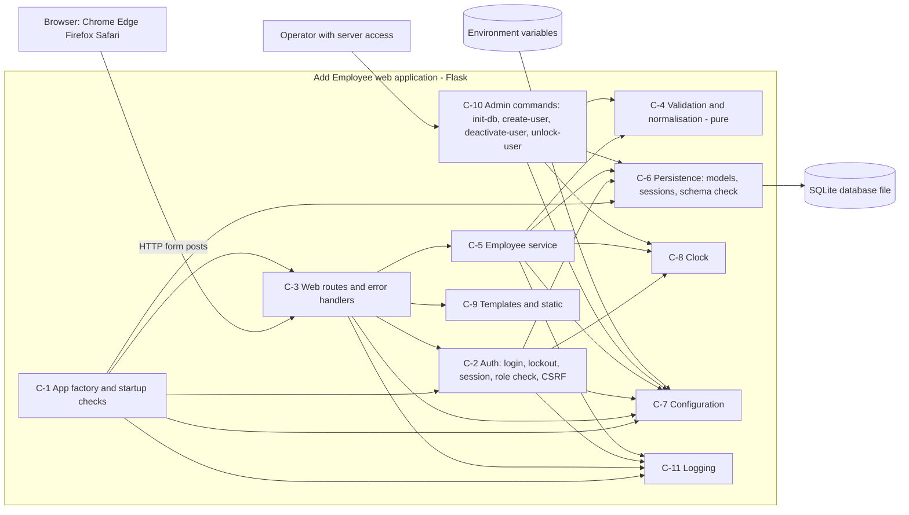
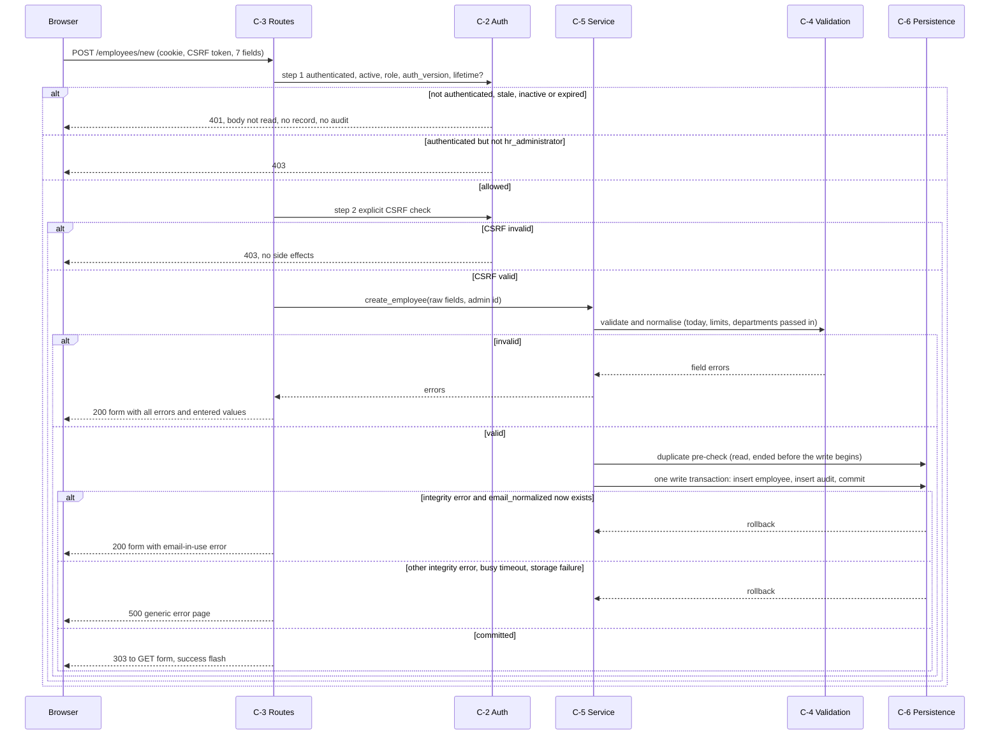
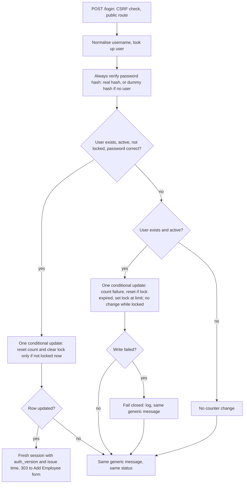

# Architecture: SCRUM-101 Add a New Employee

Input: `docs/requirements.md` (APPROVED 2026-11-20; revised 2026-11-20 with defaults adopted by user delegation) and `docs/design-review.md` (design review and re-review, verdict APPROVED_WITH_CONDITIONS).
Note: Replaces the previous doc_sync CLI architecture by user decision. Nothing is carried over.

Status:
- Original design (D-1 to D-14, OQ-A1 to OQ-A7): APPROVED by the user on 2026-11-20.
- Revision 2 content (D-15 to D-23, amendments to D-3, D-5, D-9 and D-11, OQ-A8 to OQ-A14, and the delegated requirements defaults): APPROVED by the user on 2026-11-20 as drafted ("Fix and continue").
- Revision 3 (this document: fixes for NR-01 to NR-11, the `unlock-user` command, decisions D-24 and D-25 and the changes they make to approved text): approved pending re-check. Items first introduced in Revision 3 are marked "Rev 3" below and are not otherwise approved.
- No other approval is claimed. Written sign-off records: `Not Found` (see section 13).

Convention: "Confirmed" = stated in approved requirements. "Default" = a requirements value adopted by user delegation (not a stakeholder-specified value). "Proposal" = this step's choice. Unknown = `Not Found`.

## 1. Architecture Overview

### 1.1 Summary
A small server-rendered Python 3.11 web application. HR Administrators sign in with a username/password login form, open an Add Employee form in a browser, and submit seven fields. The server validates, then creates the employee record and an audit record in one database transaction, and redisplays an empty form with a success message. Accounts are created, deactivated and unlocked by an operator-run server-side command; there is no web user-management screen.

### 1.2 Confirmed constraints (from requirements)
- Python 3.11 web app with a browser form (OQ-5).
- Login form with session login. Unauthenticated page requests redirect to login. Unauthenticated direct submissions get 401/403 and create no record (NFR-1, OQ-6).
- "Stored securely" means role-based access control only (NFR-2, OQ-7). No encryption-at-rest requirement.
- "Today" is the server date/timezone. Past = before today. Today is accepted (FR-7, OQ-4).
- Email uniqueness is case-insensitive. Email check is a basic local@domain.tld check (FR-4, FR-5).
- Phone: strip spaces, dashes, parentheses, then exactly 10 digits. "+" or country code rejected (FR-6).
- Department is a fixed dropdown list (FR-11).
- After success: stay on the cleared form with a success message (FR-9).
- Audit record of creating HR Administrator and time (FR-13).
- Login screen and HR Administrator accounts are in scope (FR-12).
- Browsers: latest stable desktop Chrome, Edge, Firefox, Safari (NFR-5).
- Out of scope: edit, delete, bulk import, payroll.

### 1.3 Defaults adopted by user delegation (requirements, 2026-11-20; confirmed by the user on 2026-11-20)
Not stakeholder-specified values. They are implemented as configuration values with these defaults so they can change without redesign.
- FR-3: whitespace-only value counts as empty.
- FR-4: email maximum 254 characters.
- FR-7 (OQ-10): no maximum future date.
- FR-12: operator-run server-side command creates and deactivates HR Administrator accounts; no web screen; passwords never from environment variables, never stored in plain text.
- FR-14: logout is a CSRF-protected POST.
- FR-15: First Name, Last Name, Job Title 1 to 100 characters after trimming; request body at most 16 KB; allowed characters `Not Found`.
- FR-16: after 5 consecutive failed logins for an account, logins for it are rejected for 15 minutes; one generic failure message; minimum password length 12, not empty, no composition rules; session timeout and other password rules `Not Found`.
- FR-17: resubmitting the same data shows the normal duplicate-email error; no idempotency.

### 1.4 User-approved addition beyond the approved requirements (Rev 3)
The user approved on 2026-11-20 an operator `unlock-user` command (clears the failed-login count and the lock for an account). This extends FR-12 beyond the approved requirement text, which lists only create and deactivate. Requirements need a matching FR/AC update; the orchestrator will request it. This document does not edit requirements. Until then `unlock-user` has no requirement id or acceptance criterion; it is traced here as "FR-12 extension (user-approved, requirements update pending)".

### 1.5 Design approach
- A single deployable Flask application (modular monolith). No separate API, no JavaScript framework, no message queue.
- Business rules (validation, normalisation, password length rule) are pure Python functions with no web or database imports.
- Values the requirements leave as `Not Found` are configuration or flagged open items (section 12).

## 2. Requirements Mapping

Component ids are defined in section 5.

| Requirement | Summary | Components | Notes |
|---|---|---|---|
| FR-1 | HR Admin can access the form | C-2, C-3, C-9 | AC-01, AC-08, AC-08b, AC-11 |
| FR-2 | Seven fields on the form | C-3, C-9, C-4 | |
| FR-3 | All fields mandatory; whitespace-only = empty (Default) | C-4 | AS-5, AS-6 |
| FR-4 | Email format, max 254 (Default) | C-4, C-7 | |
| FR-5 | Email unique, case-insensitive | C-4 (normalise), C-5, C-6 (unique index) | 7.3 |
| FR-6 | Phone: strip then exactly 10 digits | C-4 | |
| FR-7 | Joining date not before server today; no maximum (Default) | C-4, C-5, C-8 | P-13, E-2 |
| FR-8 | Valid submission creates record | C-5, C-6 | |
| FR-9 | Success message, stay on cleared form | C-3, C-9 | D-6 |
| FR-10 | Validation messages | C-4, C-9 | Wording `Not Found` |
| FR-11 | Department fixed dropdown | C-7, C-4, C-9 | Names `Not Found` (OQ-2) |
| FR-12 | Login screen; operator command creates and deactivates accounts | C-2, C-6, C-10, C-4 (password rule) | AC-11, AC-12. Extension: `unlock-user` (user-approved, requirements update pending, 1.4). Other operations (reactivate, password reset): `Not Found` (OQ-17) |
| FR-13 | Audit: who and when | C-5, C-6 | Retention/format/viewing `Not Found` (OQ-18) |
| FR-14 | Logout: CSRF-protected POST | C-2, C-3, C-6 (`auth_version`), C-9 (logout form) | AC-15, D-16 |
| FR-15 | Limits: 1-100 names/job title, email 254, body 16 KB (Default) | C-4, C-7, C-3 (413), C-6 (column sizes) | N-18, P-12, E-17 |
| FR-16 | Lockout 5 failures / 15 min, generic message, password min 12 | C-2, C-6 (counter), C-7, C-8, C-4 and C-10 (password rule) | AC-13, AC-14, N-17; D-15, D-18 |
| FR-17 | Resubmit shows duplicate-email error | C-5, C-6 | N-19, E-9; no idempotency |
| NFR-1 | Authenticated HR Admins only | C-2, C-3 | 302 for pages, 401/403 for submissions (D-5) |
| NFR-2 | Access control only | C-2 (role check), C-6, deployment constraints (8.2, 8.8) | No read endpoint exists |
| NFR-3 | Response within 3 s | C-3, C-6 | Conditions `Not Found` (OQ-12); 9.6 |
| NFR-4 | Graceful server errors | C-3, C-5 | Wording `Not Found`; D-8 |
| NFR-5 | Desktop browsers | C-9 | Plain HTML5 |
| AC-01 | Form shows 7 fields | C-3, C-9 | P-1 |
| AC-02 | Valid creation and message | C-3, C-4, C-5, C-6 | P-2 to P-4 |
| AC-03 | Empty fields error each | C-4 | N-1, N-2 |
| AC-04 | Invalid email | C-4 | N-3 |
| AC-05, AC-05b | Duplicate email incl. case-only | C-4, C-5, C-6 | N-4, N-4b |
| AC-06, AC-06b | Phone rules | C-4 | N-5, P-6 |
| AC-07, AC-07b | Past date rejected, today accepted | C-4, C-5, C-8 | N-6, P-5 |
| AC-08 | Unauth page: redirect | C-2, C-3 | N-7 |
| AC-08b | Unauth submit: 401/403 | C-2, C-3 | N-8; D-5 |
| AC-09 | Stay on cleared form | C-3, C-9 | P-8 |
| AC-10 | Audit on success only | C-5, C-6 | P-9, N-11 |
| AC-11 | Operator-created account logs in | C-10, C-2, C-6 | P-10 |
| AC-12 | Deactivated account rejected | C-10, C-2, C-6 | N-12; also invalidates open sessions (D-16) |
| AC-13 | Wrong credentials: one generic message | C-2, C-9 | N-13 |
| AC-14 | Lockout 15 min after 5 failures | C-2, C-6, C-7, C-8 | N-14; D-15 |
| AC-15 | Logout ends session | C-2, C-3, C-6, C-9 | P-11, N-15, N-16 |
| P-7 | Dropdown choice | C-7, C-9 | FR-11 |
| P-12 | Boundary lengths accepted | C-4 | FR-15 |
| P-13 | Far-future joining date accepted | C-4 | FR-7 Default |
| E-8 | Simultaneous same-email submissions | C-5, C-6 | 7.3 |
| E-9, E-15 | Double submit, refresh/back | C-3, C-5, C-6 | FR-17; PRG (D-6) |
| E-10, E-13 | Date-boundary notice to user; response over 3 s | None | Unmapped: behaviour `Not Found` in requirements; no component designed |
| E-12 | Session expiry then submit | C-2 | Rejected; data preservation `Not Found` |
| E-14 | Employee/audit write mismatch | C-5, C-6 | Resolved by atomic write (D-7) |
| E-16 | Attempts while locked, including nonexistent usernames | C-2, C-6 | Requirement leaves nonexistent-username behaviour `Not Found`; design: unknown usernames create no counter, identical generic message (D-15, OQ-A12 approved) |
| E-17 | Body over 16 KB | C-3 | 413 plain page with login link; exact response `Not Found` in requirements |
| N-9 | Storage failure graceful, no partial record | C-5, C-6 | |
| N-10 | All field errors shown | C-4, C-3 | Style `Not Found`; AS-5 |
| N-17 | Password under 12 characters or empty rejected by the command | C-4, C-10 | Requirement marks interpretation "confirm" |
| N-12 to N-19 | Account, lockout, logout, limits, resubmit scenarios | per rows above | Tests in section 9 |

## 3. Architecture Diagram

Dependency rules:
- C-4 and C-8 import neither Flask nor the database. C-5 passes today's date and the configured limits and department list into C-4, so C-4 has no dependency on C-7 or C-8.
- C-5 depends on C-4, C-6, C-7, C-8, C-11 only. Routes never call the database directly.
- C-10 depends on C-4 (password rule), C-6, C-7, C-8 (lock handling). It does not use C-1 and does not run the web-only startup checks (D-24).

### 3.1 Add Employee sequence

### 3.2 Login flow

Wrong password, unknown user, inactive, locked, and a failed counter write all end in the same generic message and status.

## 4. Technology Stack

Status: the stack was APPROVED by the user on 2026-11-20 (D-1 to D-14). Python 3.11 is confirmed by requirements. Versions are to be pinned at implementation.

| Technology | Purpose | Reason | Alternatives considered | Trade-offs |
|---|---|---|---|---|
| Python 3.11 | Runtime | Required | None | None |
| Flask (3.x) | Web framework, routing, Jinja2 templates, signed-cookie sessions | Small, well known, server-rendered forms fit, easy test client | Django: built-in auth and admin but heavier. FastAPI: API-first, weaker for HTML forms | More hand assembly than Django; revisit only if FR-12 grows beyond the command interpretation |
| Click (installed with Flask) | Operator commands (C-10) | No extra dependency | argparse | Commands must be built so they do not run web startup checks (D-24) |
| Flask-Login | Session login, user loader, redirect to login | Standard, minimal. The "remember me" cookie feature is not used (D-16) | Hand-written sessions: more risk | Roles, lockout and revocation are added by this design |
| Flask-WTF (CSRF only) | CSRF tokens | Maintained, integrates with Jinja2 | Hand-written token: higher risk | Pulls in WTForms, which is not used for validation (accepted) |
| SQLite (stdlib driver) | Employee, user and audit storage | No server to administer, transactional, unique indexes | PostgreSQL: better concurrency, suitable if OQ-12 shows high load | Single writer; file-level access control only |
| SQLAlchemy (2.x) | Models, transactions, constraint errors | Keeps most SQL portable so a later move to PostgreSQL is easier (locking, timestamps and error behaviour still differ and need re-testing) | Plain `sqlite3`: fewer dependencies but more SQL hand-written | One more dependency |
| Werkzeug password hashing | Salted password hash (scrypt) | Installed with Flask | argon2-cffi, bcrypt: extra dependency | Parameters kept current |
| pytest | Testing | Required by project rules | | |
| Production WSGI server (for example waitress) | Serve outside development | Flask dev server is not for production | gunicorn (not Windows-native) | Deployment target `Not Found` (OQ-A3) |

Practice: pin dependency versions and check Python 3.11 compatibility at implementation; vulnerability scanning: `Not Found`. No email-validation library: one regular expression satisfies the basic local@domain.tld rule.

## 5. Component Design

### C-1 Application Factory and Web Startup Checks
- Responsibility: build the Flask web app, register blueprints, extensions, error handlers and security headers, and run the web startup checks. Used for serving the web app and for tests of the web app.
- Input: optional config overrides (tests). Output: configured app.
- Dependencies: C-7, C-2, C-3, C-6, C-11.
- Which checks run where (D-24, Rev 3). Messages name the setting or object and never print values.

| Check | Web app | `init-db` | `create-user`, `deactivate-user`, `unlock-user` |
|---|---|---|---|
| Database location setting present and database reachable | Yes | Yes | Yes |
| Schema verification: required tables and unique indexes exist (`employee.email_normalized`, `user.username_normalized`, `audit_record.employee_id`) | Yes, before serving | No before creation; yes after creating (post-condition) | Yes |
| Session signing key present | Yes | No | No |
| Cookie security setting and environment mode valid; debug refused outside development | Yes | No | No |
| Department list non-empty (outside tests) | Yes | No | No |

The commands are built on a command context that loads only the database settings group and C-6; they do not call the web application factory, so none of the web-only checks can block them. `init-db` runs on an empty database and works before any department names exist.

### C-2 Authentication and Authorisation
- Responsibility: login, lockout, logout, session issue and per-request validation, role check (`hr_administrator`), CSRF enforcement in the order defined in D-5.
- Input: username, password, session cookie, request method. Output: authenticated user, redirect, or 401/403.
- Dependencies: C-6, C-7, C-8, C-11.
- Behaviour (Confirmed): unauthenticated page request redirects to login; unauthenticated non-GET submission returns 401 or 403 with no side effects.
- Per-request check (D-16, Rev 3 wording): the request is treated as unauthenticated when the session is missing; the user row is missing or inactive; the `auth_version` in the session differs from the stored value; or the issue time stored in the session is older than the configured maximum lifetime (checked on the server against the C-8 clock, not left to the browser cookie). A valid user whose role is not `hr_administrator` gets 403.
- "Remember me" persistent login is not used.
- Login follows 3.2 with lockout as one conditional update (D-15).
- After a successful login the user always lands on the Add Employee form; any `next` parameter is ignored.
- Logout (POST, CSRF protected) increments `auth_version` with a single atomic update (`value = value + 1` in the database, not read-modify-write) and clears the session. A logout with a stale or expired session is treated as unauthenticated: 401, no increment.
- 401 responses carry no `WWW-Authenticate` header, because a browser challenge dialog is not wanted for a form login; AC-08b also allows 403 (open item OQ-A15).
- Errors: invalid credentials, inactive account, locked account (all the same generic message), expired session.
- Not designed (`Not Found`): session timeout as a business rule, roles other than HR Administrator, password reset, reactivation.

### C-3 Web Routes and Error Handlers
- Responsibility: HTTP only. Routes: `GET/POST /login`, `POST /logout`, `GET /employees/new`, `POST /employees/new`. Maps results from C-5 to responses.
- Public routes (CSRF only, no authentication): `GET/POST /login`. All other routes require authentication.
- Dependencies: C-2, C-5, C-7 (department list), C-9, C-11.
- No business rules and no SQL.
- Errors: unhandled exception becomes the generic 500 page. The 401, 403, 404 and 413 pages are plain, contain no internals, and each offers a link to the login page (so an expired session is not a dead end). 413 applies when the body exceeds 16 KB (FR-15, E-17).
- Response headers (D-22): `Cache-Control: no-store` on every authenticated page, the re-rendered form, the login page and the error pages.

### C-4 Validation and Normalisation (pure functions)
- Responsibility: all field rules in 6.5 and the password rule (non-empty, at least 12 characters, no composition rules; used by C-10). Returns cleaned values or a per-field error map; collects all errors.
- Input: raw field strings, today's date, allowed departments and limits (all supplied by the caller). Output: validated employee (cleaned values plus `email_normalized`) or field errors.
- Dependencies: none on web, database, configuration or clock.
- Errors: never raises for bad user input.

### C-5 Employee Service
- Responsibility: use case "create employee". Gets today's date from C-8 and limits and departments from C-7, calls C-4, runs the duplicate-email pre-check, then calls C-6 to insert employee and audit record in one write transaction. Owns the commit.
- Pre-check scope (D-25, Rev 3): the pre-check is a read that is finished (its read transaction ended) before the write transaction starts. The write transaction is started as a write at its beginning, so waiting for another writer happens at the beginning, under the configured busy wait, rather than failing late as a lock error halfway through (to verify at implementation).
- On an integrity error it rolls back, then re-queries whether `email_normalized` exists: if yes, returns the email-in-use field error; otherwise returns a generic failure (D-20).
- Input: raw form data and creating admin id. Output: success, field errors, or failure.
- Dependencies: C-4, C-6, C-7, C-8, C-11.

### C-6 Persistence (models, sessions, schema)
- Responsibility: schema definition, engine and session lifecycle, queries and inserts for users, employees, audit records; schema verification; the conditional updates for lockout, unlock and `auth_version`.
- Entities: see 6.1.
- Session lifecycle (D-19): one scoped database session per web request, opened lazily, always closed at request teardown; anything uncommitted is rolled back. The caller of a use case (C-5, C-2, C-10) commits explicitly. Lockout updates commit in their own short transaction so a rejected login still records the failure.
- Engine settings: parameter values hidden in error messages (D-21); busy wait configured (D-20); foreign keys enabled; SQLite write-ahead journal mode (Proposal, D-25, verify at implementation) so readers do not block the writer and separate processes (web workers, operator commands) coexist.
- Errors: integrity errors, busy timeout, connection or disk errors; all roll back.
- No update or delete of employees (out of scope). The application provides no operation that alters or deletes audit rows.

### C-7 Configuration
- Responsibility: read settings from environment variables and a non-secret settings file, validate by group at startup (web group, database group), expose typed values.
- Secrets (environment only): session signing key, database credentials if any. Passwords are never read from the environment (FR-12).
- Required for the web app: database location (constraints in 8.8), signing key, `SESSION_COOKIE_SECURE` (default on; explicitly off only for local development), environment mode, department list.
- Required for operator commands: database location only.
- Non-secret settings and defaults:

| Setting | Default | Source |
|---|---|---|
| Department list | empty; names `Not Found` | FR-11, OQ-2 |
| First/Last Name and Job Title length | 1 to 100 | FR-15 (Default) |
| Email maximum length | 254 | FR-4 (Default) |
| Request body maximum | 16 KB | FR-15 (Default) |
| Maximum future joining date | none | FR-7 (Default) |
| Login failures before lock | 5 | FR-16 (Default) |
| Lock duration | 15 minutes | FR-16 (Default) |
| Minimum password length | 12 | FR-16 (Default) |
| Session maximum lifetime (technical, not a business rule) | 8 hours | D-16, OQ-A8 approved; session timeout as a business rule `Not Found` (OQ-15) |
| CSRF token lifetime | same as the session maximum lifetime (no separate shorter limit) | Proposal, Rev 3 (NR-05); library default to verify at implementation |
| Database busy wait | 2 seconds | D-20, OQ-A9 approved |
| Trusted proxy count for forwarded headers | 0 | 8.1; deployment `Not Found` |
| Slow-request log threshold | 3 seconds | Proposal, tied to NFR-3 |

### C-8 Clock
- Responsibility: current moment. Two functions: server local date (for "today", Confirmed OQ-4) and current UTC time (audit time, lock expiry, session issue time). Tests replace it.

### C-9 Templates and Static Assets
- Responsibility: login page, Add Employee page (7 fields, department `<select>`, per-field error text, success area, CSRF hidden field), logout control (a form with CSRF token and POST), error pages with a login link. Jinja2 autoescape on.
- Plain HTML5 and CSS. Any script (for example disabling the submit button after the first click) is a static same-origin file, compatible with the Content-Security-Policy, and the page works without it.

### C-10 Admin Commands (FR-12; operator with server access)
- Built on the command context described in C-1: only the database settings group is loaded; no web startup checks run.
- `init-db`: creates the schema on an empty or existing database, then verifies it.
- `create-user`: creates an HR Administrator. Username and password come from an interactive prompt (password hidden, typed twice), never from environment variables or command-line arguments (FR-12). Password checked by the C-4 rule, then hashed. Username normalised (6.1). Requires the verified schema.
- `deactivate-user`: sets `is_active` false and increments `auth_version` (atomic), so open sessions stop working on their next request (AC-12).
- `unlock-user` (Rev 3, user-approved addition, 1.4): sets `failed_login_count` to 0 and `locked_until` to null for the named account with one update. Idempotent. Does not change `is_active` or the password. An unknown username gives a clear error and non-zero exit.
- Not designed (`Not Found`, OQ-17): reactivate, password reset, delete. Forgotten passwords: no operator procedure is designed. Factual constraint: usernames stay unique including deactivated ones (6.1), so a replacement account needs a different username.
- Never prints or logs passwords or hashes.
- Errors: duplicate username, weak password, unknown username, database unavailable or schema missing (clear message, non-zero exit).

### C-11 Logging
- Responsibility: standard `logging` setup, one-line messages, redaction rules (8.7).
- Logs: startup, login success (user id), login failure (reason category only, no username), lockout events (user id), failed lockout-counter writes (user id, error category), employee created (employee id and admin id), counts of validation failures (no values), duplicate rejections, server errors with stack trace, slow requests, operator commands run (command name and user id).

## 6. Data Flow and Data Model

### 6.1 Data model

User
- id; username (as entered, trimmed); username_normalized (case-folded, unique index); password_hash; role (value `hr_administrator`); is_active; auth_version (integer, starts at 0); failed_login_count; locked_until (UTC, nullable); created_at (UTC).
- Username case-insensitivity and a 100-character technical cap are approved Proposals (OQ-A11); requirements define neither (`Not Found`).

Employee
- id (internal key, not shown to users; A-3 in requirements says other generated fields are `Not Found`); first_name (up to 100); last_name (up to 100); email (as entered after trimming, up to 254); email_normalized (case-folded, up to 254, unique index); phone (the 10 digits after stripping); department; job_title (up to 100); joining_date (date).

AuditRecord
- id; employee_id (foreign key, unique: exactly one audit row per employee); created_by_user_id (foreign key); created_at (UTC).
- Retention, format, viewing: `Not Found` (OQ-18). No screen reads it. A separate table (rather than two columns on Employee) is kept as a trade-off (D-23).
- Only successful creations write a row (AC-10, N-11).

### 6.2 Main flow: create employee
1. `GET /employees/new`. C-2 checks the session. Unauthenticated, stale, inactive or expired: 302 to `/login` (AC-08). Authenticated with another role: 403.
2. C-3 renders the form with the department list, CSRF token and any one-time success message (AC-01, AC-09).
3. User submits. C-2 checks authentication, session validity and role first (unauthenticated, stale, inactive or expired: 401; other role: 403), then CSRF (403) (D-5). The body is not read for an unauthenticated request. These are the same statuses as section 7.
4. C-5 passes raw fields to C-4, which trims, normalises and validates all seven fields against today's date, the department list and limits.
5. Invalid: C-3 re-renders with every error and entered values kept, status 200. No write (AC-03 to AC-07).
6. Valid: C-5 runs the duplicate pre-check (read, then ended); C-6 write transaction: insert Employee, insert AuditRecord, commit.
7. Integrity error: roll back; if `email_normalized` already exists, "email already in use" error (AC-05, AC-05b, E-8, FR-17); otherwise generic failure.
8. Commit: 303 to `GET /employees/new` with a one-time success message (AC-02, AC-09).
9. Any other storage error: roll back, generic 500 page (NFR-4, N-9).

### 6.3 Login and logout flow
1. `GET /login` shows the form. `POST /login`: CSRF checked (public route), then flow 3.2.
2. Lockout rule (D-15), one conditional update on the user row, evaluated by the database with the UTC time passed in:
   - Applies only when the user is active and not currently locked (`locked_until` null or not later than now). While locked, it changes nothing.
   - If the previous lock has expired, the count restarts: this failure becomes count 1 and the old lock is cleared.
   - Otherwise the count is incremented. When the new count reaches the limit (5), `locked_until` is set to now plus 15 minutes in the same statement.
   - Success: a second conditional update resets the count and clears the lock only if the account is not locked at that moment. If it updates no row (a concurrent failure just set the lock), the login is rejected with the generic message.
3. Fail closed: if the lock check read or either counter write fails (busy wait exceeded, database error), the login is rejected with the same generic message and status, and an error is logged with the user id and error category. A login is never granted without a successful success-reset write.
4. Concurrent attempts: because the lock is set by the same atomic statement that counts the failure, no increment is lost and the lock is set once. Attempts that passed the "not locked" read before the lock was set may still verify their password; so the number of wrong guesses evaluated can exceed 5 by at most the number of requests in flight at that moment. This overshoot is accepted and bounded by the worker and thread count. A correct password in such an attempt cannot create a session after the lock exists, because the success update fails (rule above).
5. Success: the session is cleared and re-issued with user id, `auth_version` and issue time (UTC); 303 to the Add Employee form, ignoring any requested target (D-17).
6. Failure of any kind (unknown user, wrong password, inactive, locked, counter write failure): the same generic message and the same status (200 with the login form).
7. Logout: `POST /logout`, authenticated and CSRF checked; `auth_version` atomically incremented; cookie cleared; redirect to login. `GET /logout` does nothing. Unauthenticated or stale logout POST: 401, no effect.

### 6.4 Operator command flow
Operator runs `init-db` once, then `create-user` (prompt for username, password twice). `deactivate-user` flips `is_active` and bumps `auth_version`. `unlock-user` clears count and lock.

### 6.5 Validation rules (C-4 only)

Trim: leading and trailing whitespace (Python's Unicode-aware strip) is removed from every field before checks. A value empty after trimming is "empty" (FR-3 Default). Errors are per field and all are returned. Length is counted in characters (code points).

| Field | Rule | Source |
|---|---|---|
| First Name | Required; 1 to 100 characters after trim. Allowed characters: `Not Found` (no restriction applied) | FR-3, FR-15 |
| Last Name | Same as First Name | FR-3, FR-15 |
| Email | Required; at most 254 characters; basic local@domain.tld (exactly one `@`, non-empty local part, domain containing at least one dot with non-empty labels, no whitespace); unique by `email_normalized` | FR-3, FR-4, FR-5 |
| Phone | Required; if it contains `+` reject; remove spaces, dashes, parentheses; the remainder must be exactly 10 ASCII digits (0-9). Letters, other characters, non-ASCII digits and other Unicode dashes fail | FR-3, FR-6 |
| Department | Required; must be one of the configured list | FR-3, FR-11 |
| Job Title | Required; 1 to 100 characters after trim; free text (list vs free text `Not Found`, OQ-11) | FR-3, FR-15 |
| Joining Date | Required; real calendar date (ISO `YYYY-MM-DD`); not before server today; no maximum | FR-3, FR-7 |

Notes:
- `email_normalized` is the trimmed email passed through `casefold()` (D-3). Unicode normalisation forms are not applied (AS-8). `casefold` may treat some distinct non-ASCII addresses as equal; accepted (AS-8).
- A country code cannot be detected in a 10-digit string; only "+" and digit count are enforced.
- Server-side validation is authoritative; HTML5 attributes are convenience only.
- The pre-check gives the friendly message in the normal case; the unique index is the real guarantee.

## 7. Error Handling

| Situation | Handling | Requirement |
|---|---|---|
| Validation failure | 200, form re-rendered with all errors and entered values; no writes, no audit | FR-10, AC-03 to AC-07 |
| Duplicate email (pre-check hit) | Field error "email already in use" | AC-05, AC-05b, FR-17 |
| Duplicate email race | 7.3 | E-8 |
| Resubmit of the same data | Duplicate-email error; accepted (7.2) | FR-17, E-9, E-15 |
| Unauthenticated page request | 302 to login | AC-08 |
| Unauthenticated, stale, inactive or expired session on a submission | 401, body not read, no side effects | AC-08b, E-12 |
| Stale, inactive or expired session on a page request | 302 to login | AC-08, AC-12 |
| Authenticated, role is not `hr_administrator` | 403 | NFR-1 |
| CSRF invalid on a protected route (authenticated caller) | 403; user data is not preserved; the page offers a link back to the form | NFR-1 |
| CSRF invalid on `POST /login` | 403, no counter change | D-5 |
| Unauthenticated or stale `POST /logout` | 401 page with login link, no effect | FR-14 |
| Login failure, inactive, locked, counter write failure | Same generic message and status as wrong credentials; failures of the counter write are logged | AC-13, AC-14, E-16 |
| Session expired while form open | Treated as unauthenticated; no record; entered data not preserved (Proposal; `Not Found` in requirements) | E-12 |
| Database busy beyond the busy wait, unavailable, disk full | Rollback, log, generic 500 page, no partial record | NFR-4, N-9 |
| Integrity error that is not an email duplicate | Rollback, generic 500 page | NFR-4 |
| Unhandled exception | Generic 500 page; debug mode refused at startup outside development | NFR-4 |
| Unparseable or invalid date | Joining date field error | E-11 |
| Body larger than 16 KB | 413 plain page with login link | FR-15, E-17 |
| Web startup misconfiguration, missing schema or index | Fail fast with message naming the setting or object (web app only) | D-19, D-24 |
| Operator command errors | Clear message, non-zero exit, no secrets printed | FR-12 |

User-facing wording for server errors is `Not Found`; Proposal is a short generic message with no technical detail.

### 7.1 Record and audit consistency (E-14) - confirmed
Employee and AuditRecord are written in one transaction: both commit or neither does. If the audit write fails, no employee is created. (D-7; OQ-A2 answered yes.)

### 7.2 Double submit and resubmission (E-9, E-15, FR-17)
- Post/Redirect/Get prevents a refresh or back action from re-sending the POST in the normal flow.
- Per FR-17 there is no idempotency. A repeated submission shows the normal duplicate-email error. Accepted consequence: after a double click, or a lost response after commit, the last page shown may be the duplicate-email error although the record was created.
- The optional static script that disables the button reduces double clicks.

### 7.3 Duplicate-email race (E-8)
Two simultaneous submissions pass the pre-check. Both try to insert. The unique index on `email_normalized` lets one commit. Handling (D-20, D-25):
- The pre-check is not held inside the write transaction. The write transaction starts as a write, so the second writer waits up to the busy wait at the beginning and then reaches the unique index, which gives an integrity error instead of a late lock error.
- On an integrity error C-5 rolls back and re-queries `email_normalized`. Found: email-in-use error. Not found: another constraint failed; generic failure.
- If the busy wait expires, the result is the generic failure (500 page), not a duplicate message. Likelihood against OQ-12 is unknown.
- The mandatory two-connection test (9.2) asserts the observed outcome rather than assuming it.

## 8. Security Architecture

### 8.1 Authentication and sessions (D-15, D-16, D-17, D-18)
- Mechanism: Flask signed-cookie session via Flask-Login. The cookie is HttpOnly, SameSite=Lax, and `Secure` set unconditionally by configuration (`SESSION_COOKIE_SECURE`, default on, explicitly off only in local development). Because the flag is a fixed setting and not derived from the scheme the app sees, TLS termination in front of the app does not weaken it. Forwarded headers are trusted only through the trusted-proxy-count setting (default 0) and are not used for security decisions.
- No claim of server-side session id regeneration is made. At login the session is cleared and re-issued.
- A signed cookie cannot be revoked by itself. Revocation uses `auth_version`: the session holds the value at login; logout and deactivation atomically increment the stored value; a mismatched session is rejected on the next request. Consequence (approved, OQ-A10): logout ends all sessions of that user. Every request also re-reads `is_active` and `role`.
- Lifetime: the session carries its issue time and the server rejects sessions older than the technical maximum (default 8 hours, approved, OQ-A8). Session timeout as a business rule: `Not Found`.
- Flash messages use the same cookie and carry only a fixed message key.
- Lockout: counter and `locked_until` are columns on User, so they survive restarts and multiple workers (6.3 gives the exact rule, fail-closed behaviour and overshoot).
- Accepted risks (user-approved with D-15): anyone who knows a username can lock that account for 15 minutes at a time, repeatedly; recovery is the operator `unlock-user` command; no per-source-address throttle is designed (not requested).

### 8.2 Authorisation (NFR-2)
- Role-based: only `hr_administrator` can reach Add Employee. Enforced on the server for every request through one mechanism in C-2.
- The application exposes no read endpoint for employee data. Any future read feature must apply the same role check.
- Storage-level enforcement depends on the deployment (8.8). No encryption at rest is designed (user-stated: access control only, OQ-A4).

### 8.3 CSRF (D-5)
- Applies to every POST: login, logout, add employee. The extension's automatic check is turned off and C-2 calls the check explicitly so it runs after the authentication step on protected routes.
- Order on protected routes: (1) authentication, session validity and role: 401 or 403; (2) CSRF: 403.
- Public route `POST /login`: CSRF checked without any authentication step; failure returns 403 and does not touch the lockout counter.
- `POST /logout`: unauthenticated or stale gets 401; authenticated with a bad token gets 403.
- Token lifetime equals the session maximum lifetime (C-7), so a form left open within a valid session stays submittable.
- Library behaviour (manual check call, hook ordering, token lifetime) must be verified at implementation; none is claimed as verified here.

### 8.4 Passwords and login responses (D-18)
- Salted hash (Werkzeug scrypt). Plain text never stored, logged or returned.
- Minimum length 12, not empty, no composition rules (FR-16), enforced by `create-user` through the C-4 rule. Other password rules `Not Found`.
- Passwords come only from the interactive prompt, never from environment variables or arguments.
- Login runs a hash comparison in every case; for an unknown user a precomputed dummy hash is compared, so the hash step itself is not a signal. Status code and body are identical for every failure cause.
- Known limitation (accepted by the user, 2026-11-20): response time can still differ between an existing active unlocked account and other cases, because only the former performs the lockout counter write. This architecture does not claim constant-time or timing-safe login and requires no equalised work. No test asserts timing equality. A timing-based way to learn whether a username exists, or is active, remains possible.

### 8.5 Secrets
Session signing key and any database credentials come only from environment variables. None is written to a file, log, commit, error page or this document. No `.env` with values is committed. Variable names are decided at implementation.

### 8.6 Input and output handling
- Server-side validation of every field; Jinja2 autoescape against XSS; parameterised queries against injection.
- Department checked against the configured list; request body capped at 16 KB.
- Post-login redirect always goes to the Add Employee form (D-17).
- Response headers (D-22): `X-Content-Type-Options: nosniff`; `X-Frame-Options: DENY`; restrictive `Content-Security-Policy` allowing only same-origin assets (no CDN, no inline script); `Cache-Control: no-store` on authenticated pages, login and error pages; `Strict-Transport-Security` sent when `SESSION_COOKIE_SECURE` is on (the TLS terminator may also set it).

### 8.7 Safe logging (D-21)
- Never logged: passwords, hashes, session cookies, CSRF tokens, the signing key, database credentials, attempted usernames (OQ-A5).
- Employee personal data (names, email, phone) is never logged; ids are logged instead.
- The database engine hides statement parameters in error messages so storage exceptions do not carry employee values. A test provokes a storage error with a known email and asserts the captured logs do not contain it; if they do, a logging filter is added.
- Stack traces are logged server-side only.
- Trade-off (accepted, OQ-A5 and OQ-A13): because usernames are not logged and every login failure returns 200, attempts against unknown usernames leave little trace; detection relies on the reason category and lockout events keyed by user id.

### 8.8 Deployment constraints (deployment target `Not Found`, OQ-A3)
HTTPS is expected to be terminated in front of the app. Target platform and operating system: `Not Found`. Whatever the target, these apply for NFR-2:
- The database location is a setting, outside any served or static directory and outside the repository; database files, including any write-ahead journal files next to it, are excluded from version control.
- The file, its journal files and its directory are owned by, and accessible only to, the service account running the application and the operator running the commands. Where the platform exposes POSIX permissions, startup of the web app logs a warning if the file is readable by others; on other platforms the equivalent access control is an operator responsibility.
- Limit: the application cannot enforce file permissions or prove them on every platform. NFR-2 enforcement at storage level is therefore the operator's responsibility; this is a residual risk, not closed by the design.
- Backups, if any, must carry the same restrictions. Backup policy: `Not Found`.
- Production runs through a production WSGI server, never the development server or debug mode.

## 9. Testing Architecture

Framework: pytest in `tests/` (project rule). Every behaviour gets a test.

### 9.1 Unit tests (no Flask, no database)
- C-4: table-driven tests for every rule: N-1 to N-6, N-10, N-18, E-4 to E-7, E-11; whitespace-only values; phone `(555) 123-4567`, `+1 555 123 4567`, 9 and 11 digits, letters, non-ASCII digits (for example Arabic-Indic), Unicode dashes; date yesterday/today/tomorrow and a far-future date (P-13) with a passed-in date; email case pairs including non-ASCII; boundary lengths 1 and 100 (names, job title, P-12), 254 (email) and one over each; password rule (empty, 11, 12 characters; N-17).
- C-7: missing or invalid settings fail fast per group; error text contains no secret values; defaults match the C-7 table.

### 9.2 Integration tests (Flask test client, temporary file SQLite database per test)
CSRF protection is enabled in the test configuration (a test asserts this).
- AC-01 to AC-10 end to end with a user created through the C-10 code path (P-1 to P-9, P-7 with a test department list).
- AC-08/AC-08b: unauthenticated GET gives 302; unauthenticated POST (with and without a CSRF token) gives 401 and Employee and AuditRecord counts are unchanged. Wrong role gives 403. Authenticated with a missing CSRF token gives 403 and no record.
- `POST /login` without CSRF token gives 403 and does not change the failure counter; unauthenticated `POST /logout` gives 401; `GET /logout` does not log out.
- AC-11 (P-10): created account logs in and opens the form. AC-12 (N-12): deactivated account is rejected, and an already-open session of that account is rejected on its next request.
- AC-13 (N-13): unknown username, wrong password, inactive account and locked account give identical status and body. A functional test confirms the dummy-hash path is taken for an unknown user (not a timing test).
- AC-14 (N-14) and E-16: 5 consecutive failures lock the account; a correct password within 15 minutes is rejected (clock replaced); after 15 minutes login works; an expired lock restarts the count at 1 on the next failure; success resets the counter; the lock survives re-creating the app on the same database file; attempts while locked neither count nor extend the lock; unknown usernames create no rows and give the same message.
- Lockout concurrency (mandatory): several real connections to a file database submit failures for one account concurrently; assert no lost increments, the lock is set exactly once, the count never exceeds the limit through lost updates, and the number of evaluated guesses beyond 5 does not exceed the number of concurrent requests. A concurrent correct-password attempt racing the 5th failure must not obtain a session after the lock exists.
- Fail closed: inject a failure into the counter write on the failure path and on the success path; assert a generic rejection, no session, and an error log entry containing no username.
- AC-15 (P-11, N-15, N-16): logout via POST ends the session; the old cookie is rejected afterwards (`auth_version`); a logout using an already-stale session returns 401 and does not increment `auth_version`; two atomic increments from separate connections are both counted.
- Session lifetime: with the clock advanced beyond the maximum lifetime the session is rejected on the next request even though the cookie is still present. "Remember me" cookie is not issued.
- Post-login redirect: a `next` parameter pointing to an external or other URL is ignored.
- AC-05b: case-only duplicate rejected. FR-17/N-19: resubmitting the same data shows the duplicate error.
- AC-09: success returns 303; following the redirect shows an empty form and the message. AC-10, N-11: one audit row on success, none on any rejected path; one audit row per employee (unique constraint).
- Atomicity (E-14, N-9): inject a failure into the audit insert and into the commit; assert no Employee row remains and the generic page has no internals.
- Race (E-8), mandatory: two real connections to a temporary file database with the pre-check bypassed so both insert; exactly one row; the test asserts and records whether the loser sees the email-in-use error or the generic failure (D-25 expects email-in-use). A second test confirms a non-email integrity error returns the generic failure.
- Department outside the configured list is rejected; body over 16 KB gives 413 (E-17) with a login link; inactive-account login.
- Schema check (web): starting the web app against a database without the unique index fails fast.
- Entry-point checks (D-24): `init-db` succeeds on an empty database with no signing key and no department list; afterwards verification passes; `create-user`, `deactivate-user` and `unlock-user` succeed with an empty department list and no signing key; the web app still refuses an empty department list outside tests; the commands refuse to run against a database without the schema.
- Dropdown content uses a test department list (real names `Not Found`).

### 9.3 Admin command tests
`create-user`, `deactivate-user`, `unlock-user` via the Click test runner: password prompt only; passwords never read from the environment (a test sets a password variable and asserts it is ignored); weak passwords rejected (N-17); duplicate username (case-insensitive) rejected; hash differs from password; output never contains the password. `unlock-user` clears a lock so the next login with correct credentials succeeds, is idempotent, leaves `is_active` unchanged, errors for an unknown username.

### 9.4 Security tests
- Capture logs during login, failed login, lockout, account creation and a provoked storage error with a known email: no password, hash, attempted username or employee value appears.
- Error pages contain no stack trace text; startup refuses debug mode outside development.
- Cookie flags (HttpOnly, SameSite, Secure when configured); response headers including `Cache-Control: no-store` on authenticated pages, the form after a failed submission, the login page, and the 401, 403 and 413 pages.

### 9.5 Browser support (NFR-5)
Plain HTML5 only. No automated cross-browser tooling is proposed; a manual smoke check on the four browsers is recommended and recorded in verification.

### 9.6 Performance (NFR-3)
Conditions `Not Found`. A smoke test asserts a single submission completes well within 3 seconds on the test machine. It is informative only and not a pass/fail gate; no load testing is designed until OQ-12 is answered.

### 9.7 Test data strategy
Factories in `tests/` build valid form dictionaries and override one field per case. Test department names are fixtures labelled as test data. No real personal data. A fixed clock fixture supplies date and time.

## 10. Technical Decisions

Status values: Approved (user, 2026-11-20); Rev 3 (introduced or changed in Revision 3, approved pending re-check; not otherwise approved).

| Id | Context | Selected approach | Reasoning | Alternatives | Trade-offs | Status |
|---|---|---|---|---|---|---|
| D-1 | Web framework | Flask with Flask-Login and Flask-WTF CSRF | Small, well known, fits server-rendered form | Django, FastAPI | More hand assembly | Approved |
| D-2 | Storage | SQLite via SQLAlchemy, easier move to PostgreSQL later | No server, transactions, unique indexes | PostgreSQL now; plain sqlite3 | Weak concurrency; revisit after OQ-12 | Approved |
| D-3 | Case-insensitive unique email | `email_normalized` (trim, `casefold()`) with unique index; show email as entered | Database enforces regardless of race | Collation (database specific) | Normalisation forms not applied | Approved (amendment included in the 2026-11-20 approval) |
| D-4 | Rules independent of web | Pure validation functions | Fast unit tests | WTForms validators | Own module to maintain | Approved |
| D-5 | AC-08b needs 401/403 before CSRF's 400 | Automatic CSRF check off; C-2 runs authentication, session validity and role first, then explicit CSRF (403) on protected routes; `POST /login` public with CSRF only (403); unauthenticated `POST /logout` gives 401; one status (403) for every CSRF failure | Deterministic outcomes, login not broken | Accept 400 for unauthenticated callers (violates AC-08b) | Custom hook ordering, tested | Approved (amendment included in the 2026-11-20 approval); Rev 3 only aligns wording |
| D-6 | FR-9 stay on cleared form | Post/Redirect/Get with one-time flash | Meets FR-9, prevents refresh resubmission | Re-render on POST | Uses session cookie | Approved |
| D-7 | E-14 consistency | One transaction for employee and audit | No partial states | Best-effort audit | Audit outage blocks creation | Approved |
| D-8 | NFR-4 graceful errors | Generic 500 page, detail only in logs | No leak | Debug output | Less help to users | Approved |
| D-9 | Limits | Configuration with FR-15 defaults; columns sized to match; allowed characters `Not Found`, none applied | Uses delegated defaults | Unbounded | Defaults not stakeholder-specified | Approved (amendment included in the 2026-11-20 approval) |
| D-10 | Departments `Not Found` | List is configuration; the web app refuses an empty list outside tests; operator commands do not need it (D-24) | Names not invented | Hard-code names | Delivery needs names | Approved; command exemption is Rev 3 via D-24 |
| D-11 | FR-12 | Operator-run commands `init-db`, `create-user`, `deactivate-user`; no web screen; prompts only, no password from environment | Matches FR-12 default | Web user management | Operator needs server access | Approved (amendment included in the 2026-11-20 approval). Rev 3: `unlock-user` added, user-approved addition beyond the requirement (1.4) |
| D-12 | Time basis | "Today" is the server local date (Confirmed); audit time, lock expiry and session issue time stored in UTC; all from C-8 | Confirmed rule plus unambiguous stored time | Store local time | Two time bases to explain | Approved |
| D-13 | Phone storage | Store the 10 digits only | Consistent data | Store as typed | Original formatting not kept | Approved |
| D-14 | Production serving | Production WSGI server behind HTTPS terminated in front; target `Not Found` (OQ-A3) | Credentials and cookies protected in transit | Dev server (rejected) | Target unknown | Approved |
| D-15 | FR-16 lockout | Counter and `locked_until` on User; lock set by one conditional update that also counts, resets after expiry and sets the lock at 5 for 15 minutes (configurable); success reset is a conditional update; fail closed with the generic message when a counter write fails; bounded overshoot accepted; rejects even a correct password while locked; no extension while locked; unknown usernames not counted; independent commit; recovery by operator `unlock-user` | Survives restarts and multiple workers, no extra component | In-memory counter; separate table; per-IP throttle (not requested) | Known-username lockout availability risk accepted | Approved (2026-11-20); Rev 3 adds the precise update rules, fail-closed rule, overshoot and `unlock-user` recovery |
| D-16 | Sessions | Signed cookie plus `auth_version` (atomic increments) for revocation; per-request reload of `is_active` and role; issue time stored and the maximum lifetime (8 h default) enforced on the server; remember-me not used; session cleared and re-issued at login | Real mechanism instead of an unsupported claim | Server-side session store | Logout ends all sessions of the user | Approved (2026-11-20); Rev 3 adds issue-time enforcement, no remember-me, atomic increment |
| D-17 | Post-login redirect | Always the Add Employee form; ignore `next` | Removes open redirect | Allow-list | No deep links | Approved |
| D-18 | Password and login | Minimum 12 enforced in `create-user`; prompt only; dummy-hash comparison for unknown users; username normalised and unique; same generic response for all failures | Meets FR-16 and FR-12 | Environment passwords (excluded) | Timing difference between existing active accounts and other cases is accepted (8.4) | Approved (2026-11-20); Rev 3 corrects the timing claim |
| D-19 | Schema and sessions | Explicit `init-db`; web app verifies tables and unique indexes at startup and fails fast; one scoped session per request, caller commits; no migration tool now | Reliable uniqueness guarantee | Alembic (add when schema changes) | Schema changes need a later decision | Approved (2026-11-20); Rev 3 scopes the checks by entry point (D-24) |
| D-20 | Duplicate race | Configured busy wait (2 s); after an integrity error re-query `email_normalized` to choose duplicate error or generic failure | Correct message without parsing database text | Parse constraint name | Busy timeout shows generic error | Approved (2026-11-20) |
| D-21 | PII in logs, deployment | Hide statement parameters; no attempted usernames logged; DB location constraints in 8.8 | Prevent PII in logs | Scrubbing filter (fallback) | Less debugging detail | Approved (2026-11-20) |
| D-22 | Hardening | Refuse debug outside development; `no-store`; HSTS when secure mode on; CSP, nosniff, frame deny | No new dependency | None | Strict CSP limits inline script | Approved (2026-11-20) |
| D-23 | Audit integrity | Unique `audit_record.employee_id`; no operation updates or deletes audit rows; separate table kept pending OQ-18 | Integrity beyond convention | Columns on Employee | One extra table | Approved (2026-11-20) |
| D-24 | Operator commands vs web startup checks (NR-01) | Web-only checks (signing key, cookie and mode settings, debug refusal, department list, pre-serving schema verification) run only for the web app; `init-db` needs only the database location and verifies after creating; user commands need database location and verified schema; commands do not call the web app factory | Bootstrap path works before departments exist | Run all checks everywhere (blocks `init-db`) | Two setting groups to maintain | Rev 3 |
| D-25 | SQLite transaction scope (NR-07) | Pre-check is a read ended before the write; write transaction begins as a write; write-ahead journal mode; race test asserts the observed outcome | Duplicate message appears reliably, not a late lock error | Pre-check inside the write transaction | Journal files must be protected too (8.8); library and database behaviour to verify | Rev 3 |

## 11. Assumptions

Distinct from open questions (section 12). Unconfirmed unless stated.
- AS-1: Requirements A-1 to A-3 apply (single HR Administrator role; messages on the form; seven stored fields plus an internal key).
- AS-2: One application instance (possibly several worker processes) serves all users; no multi-tenant needs.
- AS-3: The application is reached over HTTPS in any real deployment; TLS is terminated in front of it.
- AS-4: This story only creates employees; the application exposes no read, edit or delete.
- AS-5: Showing all field errors at once is acceptable (N-10 `Not Found`).
- AS-6: Trimming uses Unicode-aware whitespace removal; the 100/254 limits count characters (code points).
- AS-7: Only ASCII digits count for the phone rule.
- AS-8: `casefold()` of the trimmed email is sufficient for case-insensitive comparison; Unicode normalisation forms are out of scope.
- AS-9: Usernames are unique case-insensitively (stored normalised) with a technical cap of 100 characters.
- AS-10: The audit record references the User row; users are deactivated, never deleted, so references remain valid.
- AS-11: SQLite suffices for expected volumes until OQ-12 is answered.
- AS-12: Department is stored as the selected text; later list changes do not rewrite old records.
- AS-13: Operators run commands on the server hosting the application and database, as an account allowed to access the database file.

## 12. Open Questions

### 12.1 Carried from requirements (`Not Found`)
- OQ-2: Department names (blocks real configuration of the web app).
- OQ-11 residual: allowed characters in names and job title; job title free text or list.
- OQ-12: Definition of "normal operating conditions" for NFR-3.
- OQ-15 residual: session timeout as a business rule; other password rules.
- OQ-16: Roles other than HR Administrator.
- OQ-17 residual: reactivation, password reset and other account operations; forgotten-password procedure.
- OQ-18: Audit retention, format and viewing.
- Retention and PII rules (OQ-7 residual).
- E-10 whether the user is told which date applies; E-12 data preservation after session expiry; E-13 behaviour over 3 seconds; E-15 refresh behaviour beyond FR-17; N-10 error display style; wording of validation and server error messages (FR-10, NFR-4); exact response for an oversized body (E-17).
- Deployment platform and operating system (OQ-A3): `Not Found`; HTTPS expected in front of the app.
- Backup policy: `Not Found`.
- Written sign-off record for approvals: `Not Found`.

### 12.2 Architecture-level items
Answered or approved by the user on 2026-11-20:
- OQ-A1: yes, an operator-run command is sufficient for FR-12.
- OQ-A2: yes, atomic employee and audit write.
- OQ-A3: deployment target remains `Not Found`; HTTPS expected in front of the app.
- OQ-A4: access control only, no encryption at rest.
- OQ-A5: do not log attempted usernames.
- OQ-A6 (stack) and OQ-A7 (Post/Redirect/Get): covered by approval of D-1 to D-14.
- OQ-A8 to OQ-A14: approved as drafted in Revision 2 (8-hour technical session lifetime; 2-second busy wait; logout and deactivation end all sessions of the user; case-insensitive usernames capped at 100 characters; lock and counting semantics; status 200 for every login failure; prompt-only account commands).
- User-approved addition: operator `unlock-user` (1.4).
- NR-02 timing difference between existing active accounts and other cases: accepted as a documented limitation (8.4).
- DR-24 (`CLAUDE.md` still describes a CLI): left for implementation planning; not changed.

Open in Revision 3 (no user answer yet):
- OQ-A15: unauthenticated submissions return 401 without a `WWW-Authenticate` header (a deviation from HTTP convention chosen to avoid a browser login dialog). AC-08b also allows 403. Keep 401 or switch to 403?
- D-24 and D-25 (Rev 3 decisions) need approval.
- CSRF token lifetime equal to the session lifetime (C-7 table) needs approval.
- Requirements update for `unlock-user` (FR/AC) is pending; the orchestrator will request it.

### 12.3 Risks
- Known-username lockout can be triggered by anyone for 15 minutes at a time; recovery needs an operator running `unlock-user`; no per-source throttle (D-15, accepted).
- Username existence and active status may be inferred from response timing (8.4, accepted).
- Allowed characters in names are unrestricted until the OQ-11 residual is answered.
- SQLite concurrency against undefined NFR-3 conditions; busy timeout surfaces as a generic error.
- NFR-2 at storage level relies on operator-applied file permissions that the application cannot enforce (8.8).
- Real department names are needed (OQ-2) before the web app can start with real configuration.
- Library and database behaviour (manual CSRF check, hook ordering, token lifetime, parameter hiding, write-begin behaviour and journal mode on SQLite) is not verified in this document; verify at implementation.
- `CLAUDE.md` still describes a Python CLI (`doc_sync`, `PROJECT_DOC.md`) and the `src/doc_sync/` layout. Left unchanged by user decision; open item for implementation planning (DR-24). No package layout is defined here.

## 13. Approval Status

Approval trail (the user's replies were relayed through the coordinator; a written sign-off record is `Not Found`):
- 2026-11-20: the user approved the original design, D-1 to D-14, and answered OQ-A1 to OQ-A5 (OQ-A6 and OQ-A7 covered by the D-1 to D-14 approval).
- 2026-11-20 ("Fix and continue"): the user confirmed the delegated defaults (requirements FR-3, FR-4, FR-7, FR-12, FR-14 to FR-17 and related); approved D-15 to D-23; approved the amendments to D-3, D-5, D-9 and D-11; approved OQ-A8 to OQ-A14 as drafted in Revision 2; approved adding the operator `unlock-user` command (beyond the approved requirement text); accepted the NR-02 timing limitation; left DR-24 and `CLAUDE.md` for planning.
- 2026-11-20 (Step 3 approval, relayed through the coordinator): the user approved Revision 3 after the final re-check: D-24, D-25, the CSRF token lifetime equal to the session lifetime, OQ-A15 resolved as keep 401 without a `WWW-Authenticate` header, `unlock-user` with an unknown username exits with an error and changes nothing, NR-12 handled as an implementation task (skip the lockout write while a lock is active), the approval trail confirmed (delegated defaults, D-15 to D-23, OQ-A8 to OQ-A14, FR-18), and DR-24 / `CLAUDE.md` left for implementation planning.
- The requirements now contain FR-18, AC-16 and AC-17 for `unlock-user`. The architecture mapping for them (NR-13) and the WAL/operational test-plan notes (NR-14) are carried into the implementation plan as tasks.

## 14. Revision Log

| Revision | Date | Change |
|---|---|---|
| 1 | 2026-11-20 | Initial architecture for SCRUM-101. |
| 2 | 2026-11-20 | Applied design review findings DR-01 to DR-16, DR-18, DR-21, DR-22 (lockout in the User table, operator command set and traceability for FR-12, FR-14 to FR-17 and AC-11 to AC-15, CSRF and authentication ordering, session mechanism with `auth_version`, fixed post-login target, `Secure` cookie, busy wait and duplicate detection by re-query, parameter hiding, password rule, schema initialisation and session lifecycle, deployment constraints, FR-15 limits, editorial and diagram fixes, audit unique constraint, test additions). New decisions D-15 to D-23 and OQ-A8 to OQ-A14. |
| 3 | 2026-11-20 | Applied re-review findings. NR-01: web-only versus operator-command startup checks table, `init-db` and user commands no longer blocked (C-1, C-10, D-24). NR-02: timing claim removed; accepted limitation documented (8.4, D-18). NR-03: lockout defined as one conditional update with expired-lock reset, conditional success reset, fail-closed behaviour, bounded overshoot, and a mandatory concurrency test (3.2, 6.3, D-15, 9.2). NR-04: `unlock-user` added as a user-approved addition beyond the requirement, noted that a matching FR/AC update is needed (1.4, C-10, D-11, D-15); reactivation, password reset and forgotten-password procedure left `Not Found`. NR-05: 6.2 aligned with section 7, error pages with login link, CSRF token lifetime, 401 header note (OQ-A15). NR-06: server-side issue-time enforcement, no remember-me, atomic `auth_version` increment, stale-session logout behaviour (C-2, D-16). NR-07: pre-check outside the write transaction, write begins as a write, write-ahead journal (C-5, C-6, D-25, 7.3). NR-08: test plan additions in section 9. NR-09: approval trail recorded (header, section 13). NR-10: trade-off recorded in 8.7. NR-11: section 2 now maps FR-14 to C-9, E-16, E-17, N-10, N-17, P-1 to P-13 and others. Residual DR-05, DR-11, DR-12: covered by the NR-06, NR-01 and 8.8 changes; DR-12 residual stated as an operator-owned limit. DR-24 left for planning. |
